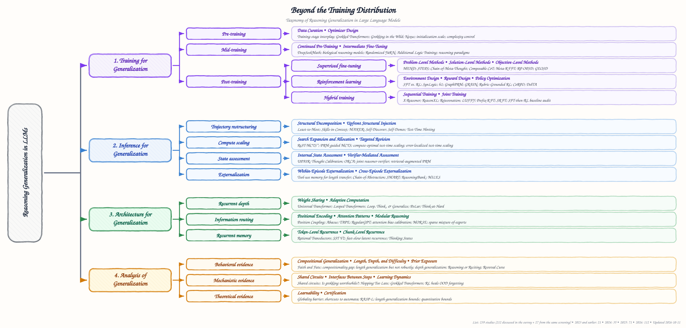
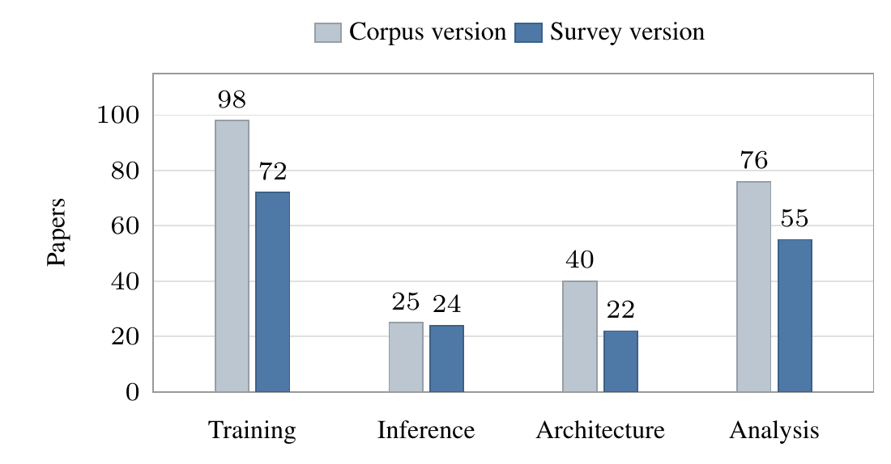

# Beyond the Training Distribution: A Survey of Reasoning Generalization in Large Language Models

This is the Markdown version of the survey; the PDF is [full_paper/paper.pdf](full_paper/paper.pdf). Its taxonomy is the one used for the paper list in [README.md](README.md), where every study discussed here is listed with links.

## Abstract

Large language models (LLMs) have achieved strong performance on mathematical, logical, and scientific reasoning tasks. However, this progress is commonly measured on benchmarks that remain close to the distributions encountered during training. Small changes in notation or problem structure, as well as deeper reasoning or new domains, can lead to substantial performance degradation, raising a central question: when and how can LLMs generalize their reasoning beyond their training distributions? This paper presents a comprehensive survey of reasoning generalization in LLMs. We organize existing work into four complementary pillars: (1) training methods that encourage transferable reasoning, (2) inference strategies that adapt computation at test time, (3) architectural designs that support reusable operations, and (4) analyses that characterize when and why generalization succeeds or fails. Building on this taxonomy, we compare the assumptions, evaluation settings, and generalization claims of representative approaches. We further summarize the main empirical findings and theoretical results, and discuss the evaluation practices and open challenges that shape this emerging research direction.

## 1. Introduction

Recent advances in prompting, post-training, and test-time computation have improved the reasoning capabilities of large language models. Models can now solve difficult mathematical problems, construct multi-step proofs, and use external tools. These advances raise a central question: when and how can LLMs generalize their reasoning beyond their training distributions?

Strong benchmark performance does not resolve this question. Accuracy can vary across equivalent numerical versions of a problem and decline when irrelevant clauses are added ([Mirzadeh et al., 2025](https://arxiv.org/abs/2410.05229)). Models also struggle with deeper or wider proof trees ([Opedal et al., 2025](https://arxiv.org/abs/2410.13502)) and unfamiliar combinations of scientific domains ([Zhiren et al., 2026](https://arxiv.org/abs/2605.14754)). Similar failures occur under symbol remapping, longer inputs, new task compositions, and changed tool interfaces. These findings suggest that success on held-out examples alone does not establish that a model has learned a reusable reasoning procedure.

Assessing reasoning generalization requires a clear account of what is "unseen". A task absent from supervised fine-tuning may still resemble pre-training data, while extra samples or tool calls may extend system performance without improving the base model. Studies also differ in scope, ranging from evaluations of frontier LLMs to experiments on small transformers and formal results under restricted assumptions. Comparisons therefore need to state what the model has encountered, what changes at test time, and which components remain fixed.

Efforts to improve reasoning generalization mainly span training, inference, and architecture. Training methods seek transferable procedures through data, objectives, and curricula. Inference methods use structured reasoning, additional computation, verification, and external memory to apply a fixed model to unfamiliar tasks. Architectural studies investigate recurrent depth, information routing, and recurrent memory. Analytical studies examine the resulting behavior, internal mechanisms, and theoretical limits. Existing surveys cover broad NLP generalization ([Hupkes et al., 2023](https://arxiv.org/abs/2210.03050)), out-of-distribution learning ([Liu et al., 2021](https://arxiv.org/abs/2108.13624)), inductive reasoning ([Chen et al., 2025b](https://arxiv.org/abs/2510.10182)), or generalization in language-model agents ([Zhang et al., 2025b](https://arxiv.org/abs/2509.16330)). A synthesis focused on how reasoning procedures transfer across explicit distribution shifts is still needed.

This survey brings these research directions together. As shown in Figure 1, we organize the literature into four pillars: Training for Generalization (Section 3), Inference for Generalization (Section 4), Architecture for Generalization (Section 5), and Analysis of Generalization (Section 6). Together, these pillars organize methods that support reasoning generalization and evidence about the conditions under which it succeeds or fails.

  

*Figure 1: Taxonomy of reasoning generalization in LLMs, with representative works for each branch. The complete list is in the README.*

Our key contributions are threefold.

1. **Systematic taxonomy.** We present a unified taxonomy that organizes studies of reasoning generalization into four pillars (Figure 1), clarifying their scope and objectives.
2. **In-depth discussion.** Building on this taxonomy, we analyze representative works, comparing training strategies, inference procedures, architectural designs, and behavioral, mechanistic, and theoretical evidence to examine when and how reasoning generalizes.
3. **Challenges and future directions.** We identify key challenges in transfer, length and depth extrapolation, and interpretability, and outline promising research directions in transferable training, stable recurrent computation, and verification (Section 7).

## 2. Preliminaries

**Definitions.** Let $x$ denote a reasoning problem, $y$ its answer, and $a$ the inference procedure applied by a model with parameters $\theta$. The resulting system is written as $f_{\theta,a}(x)$, with expected risk

$$
R_P(\theta, a) = \mathbb{E}_{(x,y)\sim P}\left[\ell\left(f_{\theta,a}(x), y\right)\right]
$$

on a distribution $P$. Evaluation is in-distribution (ID) when training and test examples follow the same relevant data-generating process, and out-of-distribution (OOD) when a specified property of that process changes ([Liu et al., 2021](https://arxiv.org/abs/2108.13624)). When the two losses are comparable, the transfer gap is $R_{\mathrm{OOD}}(\theta, a) - R_{\mathrm{ID}}(\theta, a)$. We use *reasoning generalization* to describe the ability to preserve a reasoning procedure under such a change. This includes compositional generalization to new combinations of familiar primitives ([Lake and Baroni, 2018](https://arxiv.org/abs/1711.00350)) and length generalization to longer or deeper instances ([Anil et al., 2022](https://arxiv.org/abs/2207.04901)).

**Overview.** Following Figure 1, Training for Generalization (Section 3) reviews methods that update model parameters, Inference for Generalization (Section 4) covers methods that operate on a fixed model, and Architecture for Generalization (Section 5) studies designs that support reusable computation. Beyond these methods, Analysis of Generalization (Section 6) examines what transfers and why. Methods spanning several pillars are discussed under their primary source of generalization, and Section 7 outlines open challenges and future directions.

## 3. Training for Generalization

Training-based methods update model parameters to improve reasoning generalization under shifts in surface form, composition, length, difficulty, domain, or language. The central challenge is that training can reinforce any pattern that fits the training data, including shortcuts that break under shift ([Dziri et al., 2023](https://arxiv.org/abs/2305.18654); [Mirzadeh et al., 2025](https://arxiv.org/abs/2410.05229)). We therefore organize these methods by training stage and, within each stage, by the component they modify (datasets and protocols are in Appendix C).

### 3.1 Pre-Training

At the earliest stage, pre-training provides the model with its initial knowledge and reasoning primitives (that is, basic operations). By the component they modify, methods fall into data curation and optimizer design. **Data curation** controls what the corpus contains, covering the primitives that later compositions require ([Zhang et al., 2025a](https://arxiv.org/abs/2512.07783)) and raising the ratio of inferred to stated facts so that the model acquires rules rather than memorizing ([Wang et al., 2024a](https://arxiv.org/abs/2405.15071); [Abramov et al., 2025](https://arxiv.org/abs/2504.20752)). **Optimizer design** instead changes how the model fits the same corpus, either by aligning gradients across data sources ([Chen et al., 2026a](https://arxiv.org/abs/2604.09258)) or by using small initialization and strong weight decay to favor primitives over memorization ([Zhang et al., 2024d](https://arxiv.org/abs/2405.05409); [Zhang et al., 2025d](https://arxiv.org/abs/2501.08537)), although generalizing solutions reached by training far beyond overfitting can transfer poorly to new knowledge ([He et al., 2026](https://arxiv.org/abs/2601.09049)).

### 3.2 Mid-Training

Mid-training inserts a stage between pre-training and task-specific adaptation, which narrows the gap between the pre-training and post-training distributions and supplies skills required by the target tasks; without it, a model lacking such a skill tends to memorize the tasks during post-training rather than acquire it ([Zhang et al., 2025a](https://arxiv.org/abs/2512.07783); [Jin et al., 2025](https://arxiv.org/abs/2509.12235)). By the objective of this stage, we distinguish two common approaches.

1. **Continued pre-training** methods apply next-token prediction to raw text from a domain under-represented in pre-training, directly narrowing this gap ([Shao et al., 2024](https://arxiv.org/abs/2402.03300); [Fesser et al., 2026](https://arxiv.org/abs/2606.16517)).
2. **Intermediate fine-tuning** methods train on solved problems that require no domain knowledge, such as program-generated deduction or symbolic problems, so that the acquired reasoning transfers to other domains and to realistic problems in natural language ([Morishita et al., 2024](https://arxiv.org/abs/2411.12498); [Cao et al., 2026](https://arxiv.org/abs/2602.08658)).

Beyond such direct transfer, this stage also prepares later training, after which the model generalizes better to OOD tasks and composes separately learned skills into novel combinations ([Shrestha et al., 2025](https://arxiv.org/abs/2505.13718); [RRV et al., 2026](https://arxiv.org/abs/2605.08472); [Cheng et al., 2025a](https://arxiv.org/abs/2512.01970)).

### 3.3 Post-Training

Post-training fine-tunes the model on reasoning tasks and is where the ID/OOD gap most easily opens: a model accurate on training tasks can still fail on rephrased, longer, or out-of-domain problems ([Mirzadeh et al., 2025](https://arxiv.org/abs/2410.05229); [Opedal et al., 2025](https://arxiv.org/abs/2410.13502); [Zhiren et al., 2026](https://arxiv.org/abs/2605.14754)). We cover supervised fine-tuning (SFT), reinforcement learning (RL), and hybrid training.

#### 3.3.1 Supervised Fine-Tuning

SFT trains the model to imitate demonstrations, that is, step-by-step solutions to training problems, and thus tends to memorize their spurious surface correlations, becoming brittle under shift ([Chu et al., 2025](https://arxiv.org/abs/2501.17161); [Peng et al., 2026](https://arxiv.org/abs/2605.09270)). Accordingly, SFT methods intervene at the level of the problems, the solutions, or the objective.

**Problem-level methods.** This line of work modifies the training problems so that the shift anticipated at test time is already represented in training, leaving no single surface pattern for the model to memorize.

- *Problem rewriting* presents each problem in variants that differ only in solution-irrelevant details, teaching the model that the answer stays fixed under surface shift ([Yao et al., 2025b](https://arxiv.org/abs/2502.17800); [Gui and Ji, 2025](https://arxiv.org/abs/2506.09433)).
- *Problem generation* creates problems for regions the original data does not cover, such as rare skill combinations or slightly harder instances, which strengthens compositional and length generalization ([Wei et al., 2026](https://arxiv.org/abs/2601.03676); [Lee et al., 2025](https://arxiv.org/abs/2502.01612)).
- *Difficulty curriculum* orders or selects training problems by difficulty, generalizing to harder or OOD problems ([Liu et al., 2026b](https://arxiv.org/abs/2609.25643); [Liu et al., 2026d](https://arxiv.org/abs/2605.12906)); its benefit nevertheless depends on the shift, as difficulty ordering shows no robust advantage over random sampling for compositional generalization ([Mordig et al., 2026](https://arxiv.org/abs/2603.27226)).

**Solution-level methods.** In contrast, these methods rewrite the solutions that the model imitates. The central insight is that imitation generalizes only as far as its target does, so only a target exposing a reusable procedure transfers to new problems ([Peng et al., 2026](https://arxiv.org/abs/2605.09270); [Matsutani et al., 2026](https://arxiv.org/abs/2605.28008)).

- *Abstract solutions* remove problem-specific details and teach a general strategy or rule before applying it to a specific problem, addressing surface and domain shift ([Wang and Zhang, 2026](https://arxiv.org/abs/2601.21909); [Peng et al., 2026](https://arxiv.org/abs/2605.09270)).
- *Stepwise solutions* write out every step of a rule, allowing it to run for more steps or combine with others and thus to cope with length and compositional shift ([Hu et al., 2024](https://arxiv.org/abs/2402.17709); [Wang et al., 2025](https://arxiv.org/abs/2502.18273); [Hu et al., 2025b](https://arxiv.org/abs/2502.11525); [Yin et al., 2025](https://arxiv.org/abs/2505.22635); [Hua et al., 2025](https://arxiv.org/abs/2507.13332)).

**Objective-level methods.** Inspired by knowledge distillation ([Hinton et al., 2015](https://arxiv.org/abs/1503.02531)) and invariance-based regularization from domain generalization ([Arjovsky et al., 2019](https://arxiv.org/abs/1907.02893)), these methods modify the loss so that what would not hold under shift contributes less to the update.

- *Teacher-based objectives* match the output distribution of a teacher on the student's own solutions instead of imitating a single written solution, which removes the mismatch with the expert solutions seen in training and enables transfer across domains, reasoning horizons, and languages ([Li et al., 2026b](https://arxiv.org/abs/2608.16647); [Wang et al., 2026b](https://arxiv.org/abs/2608.06347)). More selective variants restrict this matching to tokens or spans the student can support, which yields further OOD gains ([Jukic and Titov, 2026](https://arxiv.org/abs/2607.06855); [Zhao et al., 2026c](https://arxiv.org/abs/2605.28014)).
- *Regularization-based objectives* constrain or reweight the imitation loss, keeping only gradient directions shared by logically equivalent problems or reweighting samples, including wrong-answer ones, and outperform standard SFT on OOD problems ([Cheng et al., 2026](https://arxiv.org/abs/2606.05025); [Tian et al., 2026](https://arxiv.org/abs/2601.04992)).

Despite these gains, a teacher given rich privileged information can suppress the student's uncertainty and degrade accuracy on unseen problems ([Kim et al., 2026](https://arxiv.org/abs/2603.24472)).

#### 3.3.2 Reinforcement Learning

Unlike SFT, RL replaces reference solutions with a reward, usually whether a checker accepts the final answer, and updates the model toward higher-reward samples ([Shao et al., 2024](https://arxiv.org/abs/2402.03300)). Without imitation, RL reportedly generalizes to problem variants and domains where SFT degrades ([Chu et al., 2025](https://arxiv.org/abs/2501.17161); [Huan et al., 2025](https://arxiv.org/abs/2507.00432)). Yet RL generalization is bounded: OOD gains seem to appear only when the target task aligns with pre-training ([Ni et al., 2025](https://arxiv.org/abs/2510.15990)), and accuracy collapses at a few times the training depth ([Wang et al., 2026a](https://arxiv.org/abs/2605.06638)). We further group RL methods by the component they modify: the environment, the reward, or the policy update.

**Environment design.** These methods change the problems and checkers that the model practices on, and hence control which tasks, difficulties, and reasoning horizons training covers.

- *Synthesis* employs generators that turn logic tasks into checkable problems of controlled difficulty, with gains that extend to OOD puzzles and other domains ([Liu et al., 2025a](https://arxiv.org/abs/2505.19641); [Chen et al., 2025a](https://arxiv.org/abs/2505.19914)); along this line, even environments built on fictional knowledge or games transfer to real-world problems ([Kabra et al., 2026](https://arxiv.org/abs/2603.02091); [Feng et al., 2026](https://arxiv.org/abs/2604.17696)).
- *Composition* merges existing environments into tasks that require several skills at once, generalizing to unseen benchmarks ([Xiang et al., 2026](https://arxiv.org/abs/2606.12373)).
- *Chaining* feeds the answer of each short problem into the next, letting a single verifiable answer span a longer horizon and carry over to longer and harder problems ([Motwani et al., 2025](https://arxiv.org/abs/2510.07312)).

**Reward design.** Instead of changing the problems, another family changes what is rewarded. The central insight is that an outcome-only reward credits any path to a correct answer, including shortcuts that hold only in distribution; this family therefore also rewards properties of the reasoning itself.

- *Process rewards* score each intermediate step, not merely the final answer judged by outcome rewards, favoring a correct procedure over such shortcuts ([Salimi et al., 2026](https://arxiv.org/abs/2608.14791); [Peng et al., 2025](https://arxiv.org/abs/2503.00845)).
- *Rewards beyond correctness* score properties of a solution other than its answer, in three forms. Abstract-structure rewards favor solutions that capture the problem symbolically regardless of its names and narrative, narrowing the OOD gap of SFT and increasing robustness to surface perturbations ([Yuan et al., 2026](https://arxiv.org/abs/2608.27142); [Gao et al., 2025a](https://arxiv.org/abs/2506.07751)). An LLM-as-a-judge replaces or complements rule-based checkers, extending rewards to answers that rules cannot verify ([Ma et al., 2025b](https://arxiv.org/abs/2505.14652); [Bhattarai et al., 2026](https://arxiv.org/abs/2605.08061)) and raising accuracy outside the training domain ([Zha et al., 2025](https://arxiv.org/abs/2505.15034); [Ma et al., 2025b](https://arxiv.org/abs/2505.14652); [Bhattarai et al., 2026](https://arxiv.org/abs/2605.08061)). Solution-diversity rewards grant a bonus to solutions that differ from the rest of the group, yielding higher out-of-domain accuracy ([Hu et al., 2025c](https://arxiv.org/abs/2509.26209); [Zhou et al., 2025](https://arxiv.org/abs/2509.15194); [Maniparambil et al., 2026](https://arxiv.org/abs/2605.29190)).

**Policy optimization.** Rather than changing the problems or the reward, these methods modify the policy update itself, so that it does not reinforce shortcuts that hold only on the training data. Each modifies the standard GRPO update ([Shao et al., 2024](https://arxiv.org/abs/2402.03300)), in which a rollout's advantage is its reward relative to the group, $\hat{A}_i = (r_i - \bar{r})/\sigma$.

- *Advantage modification* reshapes the advantage, that is, how much a rollout outscores its group, ensuring that incorrect rollouts with partial credit never receive a positive update and strengthening OOD transfer ([Garg et al., 2025](https://arxiv.org/abs/2511.04439)).
- *Token weighting* assigns each token its own credit according to how strongly it signals a correct rather than an incorrect rollout ([Zhang et al., 2026a](https://arxiv.org/abs/2605.21467); [Xu et al., 2026b](https://arxiv.org/abs/2607.14614)), avoiding the OOD degradation of standard updates ([Xu et al., 2026b](https://arxiv.org/abs/2607.14614)).
- *Gradient regularization* penalizes the gradient norm to steer training toward flatter regions where the reward is more accurate, which curbs reward hacking, that is, the exploitation of flaws in the reward ([Ackermann et al., 2026](https://arxiv.org/abs/2602.18037)).

#### 3.3.3 Hybrid Training

Hybrid methods combine demonstrations that introduce procedures the model cannot learn on its own with rewards that recover OOD accuracy reduced during SFT ([Jin et al., 2025](https://arxiv.org/abs/2509.12235); [Fesser et al., 2026](https://arxiv.org/abs/2606.16517)). Depending on how the two signals are scheduled, we distinguish two designs.

- *Sequential training*, that is, SFT followed by RL, transfers reasoning to other domains, modalities, and languages ([Liu et al., 2025b](https://arxiv.org/abs/2505.03981); [Gurgurov et al., 2026](https://arxiv.org/abs/2604.12378)). Since excessive SFT leaves RL unable to improve, Rejuvenation partially resets the model toward its base weights before RL, restoring OOD gains ([Liu et al., 2026c](https://arxiv.org/abs/2606.09932)).
- *Joint training* combines the two signals within one stage, in the sampled solutions ([Yan et al., 2025](https://arxiv.org/abs/2504.14945); [Huang et al., 2025d](https://arxiv.org/abs/2507.01679)) or in the loss ([Fu et al., 2025](https://arxiv.org/abs/2506.19767); [Lv et al., 2025](https://arxiv.org/abs/2509.04419); [Hu et al., 2026](https://arxiv.org/abs/2605.26184); [Ma et al., 2025a](https://arxiv.org/abs/2506.07527); [Zhu et al., 2026](https://arxiv.org/abs/2604.08926)), with several methods reporting higher OOD accuracy than RL alone ([Yan et al., 2025](https://arxiv.org/abs/2504.14945); [Fu et al., 2025](https://arxiv.org/abs/2506.19767); [Lv et al., 2025](https://arxiv.org/abs/2509.04419)).

This advantage is challenged by [Limozin et al. (2026)](https://arxiv.org/abs/2604.23747): with corrected baselines, sequential training surpasses these joint methods, including OOD (Appendix C.3, Table 10).

## 4. Inference for Generalization

Autoregressive generation can compound errors on out-of-distribution tasks. Test-time interventions target different parts of the inference process: structuring trajectories (trajectory restructuring), exploring alternatives (compute scaling), evaluating reasoning reliability (state assessment), and using external state or tools (inference-time externalization). We group methods by their primary intervention, even when they also serve secondary roles. Their effectiveness remains bounded by model capabilities: inference scaling cannot synthesize algorithmic reasoning entirely absent from training ([Tong et al., 2026](https://arxiv.org/abs/2604.15306)). Empirical evidence and evaluation caveats are summarized in Table 15, with benchmarks and metrics in Tables 13 and 14 (Appendix C.4).

### 4.1 Trajectory Restructuring

These methods organize free-form generation without updating model weights. **Structural decomposition** breaks complex reasoning into manageable steps ([Zhou et al., 2023](https://arxiv.org/abs/2205.10625); [Zhang et al., 2024c](https://arxiv.org/abs/2402.05359)), using independently executed micro-agents ([Meyerson et al., 2025](https://arxiv.org/abs/2511.09030)) or predefined atomic skills ([Chen et al., 2024](https://arxiv.org/abs/2308.00304)). **Upfront structural injection** constrains generation in advance by restricting valid answers ([Ma et al., 2026](https://arxiv.org/abs/2608.05254)), constructing task-specific procedures ([Zhou et al., 2024b](https://arxiv.org/abs/2402.03620)), or synthesizing query-specific demonstrations ([He et al., 2024b](https://arxiv.org/abs/2404.00884)). The latter addresses out-of-demonstration generalization, which should not be equated with an explicit shift from the pre-training distribution.

### 4.2 Compute Scaling

When one trajectory is insufficient, extra test-time compute can explore alternatives or revise errors. **Search expansion and allocation** uses process-level signals to guide exploration: ReST-MCTS* combines a process reward model (PRM) with Monte Carlo tree search (MCTS) to score partial solutions ([Zhang et al., 2024a](https://arxiv.org/abs/2406.03816)), while MCTS can also improve policy and reward models for finer inference guidance ([Chan et al., 2025](https://aclanthology.org/2025.findings-acl.388/)). Adaptive methods allocate compute according to estimated problem difficulty ([Snell et al., 2024](https://arxiv.org/abs/2408.03314)), although this alone does not establish OOD generalization. **Targeted revision** concentrates computation on faulty reasoning steps rather than regenerating an entire solution ([Chitale et al., 2026](https://arxiv.org/abs/2607.21453)).

### 4.3 State Assessment

State assessment estimates the reliability of intermediate reasoning to guide selection or further computation. **Internal assessment** draws on residual-stream trajectories ([Damirchi et al., 2026](https://arxiv.org/abs/2608.05660)), uncertainty-progress alignment ([Yan et al., 2026](https://arxiv.org/abs/2607.17188)), or thought calibration for risk-controlled stopping ([Wu et al., 2025](https://arxiv.org/abs/2505.18404)). Online calibration can further update reliability estimates under distribution shift ([Zhou et al., 2026](https://arxiv.org/abs/2604.01170)). **Verifier-mediated assessment** uses auxiliary models for candidate selection or adaptation: joint reasoner-verifier training supports inference-time selection in evaluated mathematical and physics tasks ([Sareen et al., 2025](https://arxiv.org/abs/2505.04842)), while verifier-guided test-time training adapts the generator using high-confidence outputs on unlabeled target data ([Moradi et al., 2025](https://arxiv.org/abs/2505.19475)). However, PRMs can generalize poorly to harder problems or to solutions from different models ([Zhu et al., 2025a](https://arxiv.org/abs/2502.14361)).

### 4.4 Inference-Time Externalization

Externalization gives inference access to working state or computation beyond the model's internal state. **Within-episode externalization** uses interactive memory to support length extrapolation ([Malach et al., 2026](https://arxiv.org/abs/2510.14826)), separates abstract reasoning from tool-supplied values ([Gao et al., 2025b](https://arxiv.org/abs/2401.17464)), and supports tool selection or restraint ([Alazraki and Rei, 2025](https://arxiv.org/abs/2411.04535); [Qian et al., 2025](https://arxiv.org/abs/2502.11435)). These gains do not by themselves establish that the model generalizes without external resources. **Cross-episode externalization** stores strategies distilled from prior successes and failures in persistent memory ([Ouyang et al., 2026](https://arxiv.org/abs/2509.25140)); modular sub-instructions and learned selection mechanisms support memory retrieval ([Tong and Gong, 2026](https://arxiv.org/abs/2607.06974)), although cross-domain transfer is not directly established by the main evaluations.

## 5. Architecture for Generalization

Architectural approaches change the computation available to a model: how it reuses transformations, connects representations, or carries state forward. Such changes provide inductive biases that can support reasoning generalization by allowing a model to reuse learned operations when problems grow longer or combine familiar steps in new ways.

### 5.1 Recurrent Depth

Recurrent depth repeatedly applies a shared transformation, increasing computation without a separate parameter set at each depth ([Geiping et al., 2026](https://arxiv.org/abs/2502.05171); [Zeng et al., 2025a](https://arxiv.org/abs/2505.20674); [Zhu et al., 2025c](https://arxiv.org/abs/2507.06203)). This can support length generalization when longer problems require more iterations of the same operation, as shown on controlled algorithmic tasks ([Fan et al., 2025](https://arxiv.org/abs/2409.15647)). Designs differ in which computation is reused and how its iteration count is adjusted across inputs or tokens.

**Weight sharing.** Universal Transformers share a transition across depth ([Dehghani et al., 2019](https://arxiv.org/abs/1807.03819)). Shared recurrent blocks support generalization to deeper compositions of facts ([Kohli et al., 2026](https://arxiv.org/abs/2604.07822)). On computation graphs, recurrence combined with latent supervision, discretization, and error correction enables generalization to larger instances ([Altabaa et al., 2025](https://arxiv.org/abs/2510.14095)). In pretrained language models, a shared middle block supports depth extrapolation on controlled rule-following tasks, although zero-shot transfer to verbal formulations remains limited ([Shapiro, 2026](https://arxiv.org/abs/2608.11233)). Looped language models also improve compositional tool calling involving dependent calls ([Popescu et al., 2026](https://arxiv.org/abs/2608.18171)).

**Adaptive computation.** PoLar learns input-dependent programs that skip or repeat groups of layers in a frozen backbone ([Li et al., 2026c](https://arxiv.org/abs/2606.06574)). Think-at-Hard selects tokens for extra latent iterations, and its math-only variant also improves on MMLU-STEM ([Fu et al., 2026](https://arxiv.org/abs/2511.08577)). Extra iterations can still degrade predictions when recurrent states drift, limiting depth extrapolation ([Viakhirev et al., 2026](https://arxiv.org/abs/2608.18222)).

### 5.2 Information Routing

Information routing determines how tokens are addressed, which dependencies attention can access, and which components process them ([Vaswani et al., 2017](https://arxiv.org/abs/1706.03762); [Shazeer et al., 2017](https://arxiv.org/abs/1701.06538)). For reasoning generalization, these designs aim to preserve the connections needed by a computation as input length or composition changes.

**Positional encoding.** Position Coupling assigns shared position identifiers to digits of equal significance across operands ([Cho et al., 2024](https://arxiv.org/abs/2405.20671)), while Abacus embeddings encode digit positions within each number ([McLeish et al., 2024](https://arxiv.org/abs/2405.17399)). Structural symmetry and alternative positional representations also improve arithmetic extrapolation ([Sabbaghi et al., 2024](https://arxiv.org/abs/2406.01895); [Shen et al., 2023](https://arxiv.org/abs/2311.14737)). Multi-level position coupling combines multiple position coordinates with task-specific scratchpads to generalize across operand lengths and counts ([Cho et al., 2025](https://arxiv.org/abs/2410.15787)). TAPE instead updates positional representations across layers using sequence context, improving arithmetic length extrapolation ([Zhu et al., 2025b](https://arxiv.org/abs/2501.00712)). Much of this arithmetic evidence comes from specialized models.

**Attention patterns.** RegularGPT combines sliding-dilated attention with shared layers and length-dependent depth, composing local results over larger spans to recognize regular languages beyond training lengths ([Chi et al., 2023](https://arxiv.org/abs/2305.03796)). Attention Bias Calibration converts attention patterns learned on shorter inputs into biases that support arithmetic length extrapolation ([Duan et al., 2023](https://arxiv.org/abs/2310.11984)).

**Modular reasoning.** MORSE learns input-dependent masks that route tokens to specialized attention heads, improving generalization across entailment-tree lengths and shapes ([Fu and Frank, 2024a](https://arxiv.org/abs/2309.07624)). In sparse expert language models, more complex skill compositions benefit from more active experts, while excessive activation can hurt simpler compositions ([Zhao et al., 2026b](https://arxiv.org/abs/2410.13964)).

### 5.3 Recurrent Memory

Recurrent memory carries an internal state across computation steps, allowing later steps to reuse earlier information ([Bulatov et al., 2022](https://arxiv.org/abs/2207.06881)). Updates occur across tokens or reasoning chunks, and generalization depends on retaining the needed information as sequences grow.

**Token-level recurrence.** Rational Transductors combine weighted-automaton recurrence with transformer attention, providing theoretical and synthetic-task evidence for length generalization ([Mohri, 2026](https://arxiv.org/abs/2602.07599)). SST V2 blends a carried state into pretrained feedforward layers and reports gains beyond math fine-tuning, although its aggregate scores count a question as solved if any tested iteration depth succeeds ([Aviss, 2026](https://arxiv.org/abs/2605.00206)).

**Chunk-level recurrence.** Thinking States compresses intermediate thoughts into a fixed-size state for later chunks, improving length extrapolation on parity and variable-tracking tasks, although the model still accesses the preceding context alongside this state ([Amos et al., 2026](https://arxiv.org/abs/2602.08332)).

## 6. Analysis of Generalization

While the methods in Sections 3 to 5 aim to improve performance under distribution shift, analytical studies examine what actually transfers and why. We organize this work by three complementary types of evidence: behavioral evidence measures performance under controlled shifts; mechanistic evidence probes internal computation, mostly in small models; and theoretical evidence characterizes what can be represented, learned, and certified. Table 16 summarizes each line of analysis, with details in Appendix D.

### 6.1 Behavioral Evidence

**Compositional generalization.** Accuracy declines as computation graphs grow deeper and wider ([Dziri et al., 2023](https://arxiv.org/abs/2305.18654)), models can fail to chain two facts they both know ([Zhang et al., 2026b](https://arxiv.org/abs/2608.07261)), and this gap does not shrink with scale in the GPT-3 family ([Press et al., 2023](https://arxiv.org/abs/2210.03350)).

**Length, depth, and difficulty.** Transformers fail on nesting deeper than seen in training ([He, 2025](https://arxiv.org/abs/2512.02677)), short-to-long transfer varies across random seeds ([Zhou et al., 2024d](https://arxiv.org/abs/2402.09371)), and training only on easy or only on hard examples yields inconsistent gains ([Kordi et al., 2026](https://arxiv.org/abs/2511.21692)).

**Prior exposure.** Whether a test is "unseen" depends on the training stage it is compared against: accuracy drops on familiar tasks posed in an unfamiliar number base ([Wu et al., 2024](https://arxiv.org/abs/2307.02477)), facts learned as "A is B" are not retrieved as "B is A" ([Berglund et al., 2024](https://arxiv.org/abs/2309.12288)), and RL transfer requires sufficient base-model competence ([Lu et al., 2025](https://arxiv.org/abs/2512.20760)).

### 6.2 Mechanistic Evidence

Mechanistic studies reveal how internal computations shape generalization.

**Shared circuits.** If two problem variants are solved by the same procedure, their internal computations should overlap. [de Varda et al. (2026)](https://arxiv.org/abs/2609.04463) show that, in LLM arithmetic, the overlap between circuits for numeric and verbal formats predicts which formats are hardest, which models transfer best, and which items are solved. However, such a circuit can transfer poorly once it must use newly integrated knowledge ([He et al., 2026](https://arxiv.org/abs/2601.09049)).

**Interfaces between steps.** Multi-step reasoning can also fail when an intermediate result does not reach the next step. [Biran et al. (2024)](https://arxiv.org/abs/2406.12775) find that LLMs resolve the bridge entity of a two-hop query in early layers but begin the second hop in later layers that may lack the required knowledge; patching a later hidden state into an earlier layer, chosen per query, recovers up to 66% of failed queries.

**Learning dynamics.** When several solutions fit the training data, optimization determines which one the model reaches. Grokked transformers generalize OOD on comparison but not on composition ([Wang et al., 2024a](https://arxiv.org/abs/2405.15071)). In LLM post-training, OOD performance can peak early in SFT and then decline while ID performance still improves ([Jin et al., 2025](https://arxiv.org/abs/2509.12235)), making the evaluated checkpoint part of the generalization claim.

### 6.3 Theoretical Evidence

Theoretical work distinguishes three properties that empirical results often conflate: *expressivity*, whether a model class can represent a procedure that generalizes in length or composition; *learnability*, whether finite training selects this procedure over shortcuts that fit the same data; and *certification*, whether a finite test can establish that it extrapolates. Each result holds only under its stated encoding, precision, and computation budget.

**Learnability.** Two conditions govern whether training selects the extrapolating procedure. The first is locality: [Abbe et al. (2024)](https://arxiv.org/abs/2406.06467) show, theoretically under additional assumptions and empirically, that targets with a high globality degree are not efficiently learnable by regular transformers, whereas inductive scratchpads, which condition each step only on the question and the previous state, break this barrier and improve length transfer. The second is inductive bias: [Liu et al. (2023)](https://arxiv.org/abs/2210.10749) prove that $O(\log T)$ layers suffice to simulate any finite automaton on inputs of length $T$, yet standard training in their experiments finds shortcuts that are brittle outside the training distribution.

**Certification.** [Yang et al. (2026a)](https://arxiv.org/abs/2603.02238) prove that no computable length generalization bound exists for C-RASP, even with two layers, so no computable test length certifies the class. Positive results hold only for narrower classes: one- and two-layer transformers provably length-generalize when behavior on longer sequences can be simulated by behavior on shorter training sequences ([Izzo et al., 2026](https://arxiv.org/abs/2510.27015)).

## 7. Challenges and Future Directions

**Challenges.**

1. *Limited transfer.* Models that perform well on familiar tasks can fail when known reasoning steps are combined in new ways or applied to different domains (Section 6.1). Learning procedures that remain effective under these changes is still a major challenge.
2. *Length and depth extrapolation.* Accuracy can decline when problems require more reasoning steps than those seen during training ([Wang et al., 2026a](https://arxiv.org/abs/2605.06638)). Additional computation at inference does not always resolve this difficulty, as recurrent states may drift ([Viakhirev et al., 2026](https://arxiv.org/abs/2608.18222)).
3. *Interpretability.* Behavioral scores alone do not show whether a model reuses the same reasoning procedure across tasks. Many mechanistic studies use small models, and their findings may not fully explain transfer in frontier LLMs (Section 6.2).

**Future directions.**

1. *Transferable training.* Developing training methods that teach reusable operations is central to improving generalization. Supervision should emphasize the reasoning steps that remain useful when familiar operations are combined in new ways (Section 3).
2. *Stable recurrent architectures.* Developing recurrent architectures with stable state updates may improve reasoning on longer and deeper problems. These architectures should maintain reliable computation as the number of reasoning steps increases (Section 5).
3. *Interpretability and verification.* Developing methods to identify and verify reusable computations is important for understanding reasoning generalization. Applying these methods to larger models would help connect mechanistic findings with the failures observed under distribution shift (Section 6.2).

## 8. Conclusion

This survey reviews reasoning generalization in LLMs from four perspectives: training, inference, architecture, and analysis. Existing studies show that generalization depends on what models learn, the computation available at inference, and the type of distribution shift. Although current methods achieve promising results in specific settings, none consistently generalizes across different shifts. Future research should develop clearer evaluation protocols and better explain when and why reasoning generalizes.

## Limitations

While this survey offers a comprehensive review of existing methods and analyses of reasoning generalization in LLMs, a few limitations remain in literature coverage, comparison across studies, and applicability to larger models. Given the broad scope and rapid growth of this field, our review may have missed some relevant studies. Our focus on explicit reasoning-related distribution shifts limits coverage of related work and leaves relatively few inference studies. Differences in models, tasks, metrics, and compute restrict the synthesis to qualitative comparisons. Many mechanistic and theoretical findings rely on small models or idealized assumptions, so their relevance to larger models remains uncertain. Finally, our taxonomy assigns each study a primary pillar, although some methods span several.

## Ethical Considerations

This work surveys publicly available research on reasoning generalization in LLMs and does not involve human participants, collect new personal data, or train or release new models. Reasoning methods may be used for both beneficial and harmful purposes, and improved transfer on selected benchmarks does not establish that a model is safe or reliable in deployment. We therefore encourage assessing generalization alongside bias, privacy, and misuse risks, especially in applications where reasoning errors can harm users.

## Appendix A. Literature Collection and Corpus

### A.1 Abstract-Based Retrieval

We searched arXiv abstracts for literature available by 22 September 2026, using terms such as "reasoning generalization", "reasoning transfer", "OOD reasoning", "compositional generalization", "systematic generalization", and "length generalization". Supplementary searches used "post-training", "SFT", "GRPO", "RLVR", and "reward" to broaden coverage of training methods. We also checked relevant papers in ACL Anthology and OpenReview.

### A.2 Screening and Corpus Construction

After deduplication, we screened abstracts and consulted full papers for studies of reasoning transfer, its mechanisms, or theoretical limits. Empirical transfer claims had to specify the reasoning task, reference exposure, and test shift; benchmark gains alone were insufficient. We excluded unrelated robustness or model-to-model transfer studies, while retaining relevant methods without direct transfer evidence as context. The *corpus version* contains 239 studies across the four pillars, of which 173 form the *survey version*, covering the main text, taxonomy, and appendix evidence. Each paper is counted once under its primary pillar; background, survey, and dataset-only references are excluded. [Figure 4](assets/corpus.pdf) and Table 1 summarize both versions.

*Figure 4: The corpus version (239 studies) and the author-selected survey version (173 studies), by primary pillar. Each paper is counted once.*

*Table 1: Catalogue and survey studies by primary pillar and first-posting year. Venue year is used for records without an arXiv version.*

| Pillar | Version | 2023 and earlier | 2024 | 2025 | 2026 | Total |
| --- | --- | --- | --- | --- | --- | --- |
| Training | Corpus | 0 | 5 | 42 | 51 | 98 |
| Training | Survey | 0 | 4 | 33 | 35 | 72 |
| Inference | Corpus | 2 | 7 | 9 | 7 | 25 |
| Inference | Survey | 2 | 7 | 9 | 6 | 24 |
| Architecture | Corpus | 6 | 7 | 5 | 22 | 40 |
| Architecture | Survey | 4 | 6 | 3 | 9 | 22 |
| Analysis | Corpus | 13 | 16 | 15 | 32 | 76 |
| Analysis | Survey | 10 | 10 | 12 | 23 | 55 |
| **Total** | Corpus | 21 | 35 | 71 | 112 | 239 |
| **Total** | Survey | 16 | 27 | 57 | 73 | 173 |

**Repository files.** The catalogue retains all 239 four-pillar studies, including 173 cited in the current survey and 66 additional studies. The manifest [`paper_manifest.tsv`](data/paper_manifest.tsv) records metadata and survey-selection flags for these studies, ten background references, and five related surveys. [`excluded_papers.tsv`](data/excluded_papers.tsv) records screening exclusions, and [`resources.tsv`](data/resources.tsv) lists datasets and benchmarks.

## Appendix B. Synthesis and Evaluation Framework

### B.1 Connections Across Pillars

The four pillars describe different parts of one process. Training supplies reasoning primitives and determines which of several fitting procedures the model prefers (Section 3). Architecture constrains which computations can be represented and repeated efficiently (Section 5). Inference controls how a learned procedure is elicited, searched, checked, or supplemented with external resources (Section 4). Analysis tests whether the resulting behavior survives the intended shift and whether the proposed explanation holds (Section 6).

These parts interact, so improvements in one can remain limited by weaknesses in another. Intermediate reasoning steps help when they expose a reusable computation: in tiny transformers, the gain from traces comes from their content rather than from the extra tokens ([Valle and Reid, 2026](https://arxiv.org/abs/2608.04980)), and scratchpads improve length transfer when each step depends only on the question and the previous state ([Abbe et al., 2024](https://arxiv.org/abs/2406.06467)). Recurrent depth helps only while its update remains stable, since recurrent states can drift as the number of iterations grows ([Viakhirev et al., 2026](https://arxiv.org/abs/2608.18222)). Tools can extend what a system solves without changing what the model has learned. With access to external memory, state-space models extrapolate to inputs far longer than those seen in training ([Malach et al., 2026](https://arxiv.org/abs/2510.14826)); without external memory, the same models remain limited by their bounded internal state.

Training and inference also constrain each other. Test-time scaling cannot produce reasoning that is entirely absent from the training distribution ([Tong et al., 2026](https://arxiv.org/abs/2604.15306)), and a model trained under one decoding procedure may not cooperate with the controller used at deployment. Placing inference-time controllers in the training loop improves transfer to new inference workflows compared with training for a single controller ([Choudhury et al., 2026](https://arxiv.org/abs/2607.23771)).

Tables 3 and 4 summarize each branch of the training and inference pillars. The training table gives the mechanism through which a branch is expected to support transfer, the strongest current evidence, and the main risk. The inference table gives the conditions under which a branch helps or fails and the control needed before a gain can be read as transfer.

*Table 3: Training branches: how each is expected to support transfer, the strongest current evidence, and the main risk.*

| Training branch | Transfer mechanism | Strongest current evidence | Main risk |
| --- | --- | --- | --- |
| Pre-training | Establish reusable capabilities before adaptation | Controlled training-stage and large-pass@$k$ comparisons | Opaque exposure makes the boundary hard to identify |
| Mid-training and curricula | Expose positions, procedures, or domains absent from base training | Long-context and verified-synthesis transfer | More data may repeat the same shortcut |
| SFT and distillation | Teach explicit operations and reachable traces | Checkpoint sweeps, cross-model transfer, logically isomorphic OOD tests | Teacher forcing, late-stage overfitting, suppressed uncertainty |
| RL and RLVR | Select and sometimes compose procedures with outcome or process feedback | Held-out domains, capability-controlled pass@$k$, composed environments | Reward hacking, entropy collapse, domain interference, dependence on base competence |
| Hybrid SFT and RL | Combine demonstrations with on-policy exploration | Shared ID/OOD protocol on OpenR1-Math-46k (Table 10) | Gains shrink against correctly implemented SFT then RL; single-run reproductions |
| Self-improvement and controller-aware training | Learn reusable skills or cooperation with inference controllers | Unseen skill combinations and held-out controller compositions | Specialization to the combinations seen in training |

*Table 4: Inference branches (Section 4): when each helps, when it fails, and the control needed to claim transfer.*

| Inference branch | Helps when | Fails when | Required control |
| --- | --- | --- | --- |
| Trajectory restructuring | The task representation is misaligned or intermediate structure is missing | The decomposition is wrong or prompt-sensitive | Matched prompts and paraphrase tests |
| Compute scaling | Correct paths exist with low but nonzero probability | No useful candidate is generated | pass@$k$ and an oracle-selection upper bound |
| State assessment | Errors are easier to detect than to avoid, or difficulty varies across examples | The verifier shares the generator's shortcut, or the monitor is specific to the source distribution | Independent checks and source-to-target accuracy-cost frontiers |
| Externalization | Exact operations or reusable skills can be moved outside the model | Tool routing or retrieval fails | Tool-free and retrieval-distance controls |

### B.2 Evaluation Framework

**Claim boundaries.** A generalization result should specify which components are evaluated and held fixed, as gains enabled by prompting, search, verification, or memory need not hold for the model alone. Generation must also be distinguished from selection: greedy accuracy shows what a model produces reliably, large-pass@$k$ accuracy what it can produce occasionally, and verifier-selected accuracy what a larger system can recover. Gains on the matched target distribution show specialization, whereas gains under held-out shifts provide evidence of reuse. Stating these conditions makes comparisons clearer without treating every gain as evidence of the same capability.

**Elements of a claim.** Table 5 lists the minimum information needed to place a result within these boundaries. The test shift needs to be constructed so that its effect can be attributed: each OOD condition has a matched ID control, one factor changes at a time where possible, and the suite includes both surface and structural changes (Table 7). Explanatory claims need controls of their own. A proposed mechanism should be tested with counterfactual rules or perturbations across several task families, training seeds, and checkpoints, and a causal intervention should be evaluated on the split that established the behavioral effect, because a mechanism identified on familiar data need not operate under the shift (Section 6.2).

*Table 5: Information required to interpret a reasoning-generalization claim, and the misreading each field prevents.*

| Field | Minimum report | Misreading prevented |
| --- | --- | --- |
| Reasoning task | Generator or dataset, target output, metric, and relevant constraints | Treating a broad benchmark score as evidence about one reasoning process |
| Reference exposure | Pre-training knowledge if available; all continued-training, SFT, distillation, RL, and adaptation data | Calling an item unseen only because it was absent from the last training stage |
| Evaluated components | Whether weights, prompts, exemplars, controller, verifier, memory, retriever, and tools remain fixed | Attributing gains from inference methods or external resources to changes in learned model capabilities |
| Test shift | Named axis, construction method, distance or level, and matched ID control | Combining instance, surface, composition, length, and domain shifts into one OOD label |
| Outcome and evidence | Performance with uncertainty, generalization gap when comparable, mechanism test if claimed | Treating a probe, score change, or finite test range as stronger evidence than it provides |
| Inference cost | Samples, generated tokens, tool calls, wall time or FLOPs, and stopping rule | Reporting an accuracy gain that follows only from unbounded extra computation |

**Generation and selection.** Separating generation from selection requires an explicit budget, because accuracy can rise simply through more samples, tokens, verifier calls, or tool interactions. A comparison should either fix this budget or report an accuracy-cost frontier, with all quantities measured under the same shift. Oracle-selection accuracy adds an upper bound on what any verifier could recover from the generated candidates. The gap between the selector actually used and this oracle measures the quality of the selector, and verifier errors on shifted inputs show whether the verifier shares the generator's shortcuts. Comparing pass@$k$ with greedy accuracy is also informative for trained models, since post-training may mainly raise the probability of an existing solution instead of introducing a new one ([Yue et al., 2025](https://arxiv.org/abs/2504.13837)). Appendix C.2 defines these metrics.

**Generalization matrix.** A generalization matrix replaces a single ID/OOD pair with a grid of training and test conditions. Let $M_{ij}$ record performance and inference cost for training condition $i$ and test condition $j$. Each row contains a matched ID entry, which we treat as its diagonal entry, and each column keeps the task and metric fixed wherever possible (Table 6). Reading along a row shows which shifts an intervention handles, and reading down a column compares interventions on the same test condition. A high diagonal entry shows that an intervention works on the distribution it was designed for, whereas consistent gains off the diagonal show that it transfers beyond the distribution used to build its data, reward, prompt, or controller. If the loss or metric differs across columns, normalized changes or per-task results are more meaningful than raw gaps.

*Table 6: Template for a generalization matrix. Each score should include uncertainty, and each cost should use the same budget definition across columns. The rows can be replaced with the training conditions of a particular study.*

| Training exposure | Matched ID | Surface shift | New composition | Longer / deeper |
| --- | --- | --- | --- | --- |
| Base model | score / cost | score / cost | score / cost | score / cost |
| SFT or distillation | score / cost | score / cost | score / cost | score / cost |
| RL or hybrid training | score / cost | score / cost | score / cost | score / cost |
| Fixed-model inference method | score / cost | score / cost | score / cost | score / cost |

**Asymmetry and interaction.** The matrix also exposes two effects that a single OOD score hides. Transfer can be asymmetric: training on a structurally diverse source may help a narrow target even when the reverse direction fails, so both directions should be reported before a favorable pair is taken as a property of the method. Shifts can also interact. Adding single-factor columns and their intersections separates independent gains from interactions, which is what the study of compound shifts requires.

**Uncertainty and exposure.** Each cell should report uncertainty over test items and, where feasible, over training seeds, prompts, and checkpoints. A gain that appears for one prompt wording or one checkpoint is weaker evidence than a gain that persists across these choices. Exposure audits should be reported separately, since a narrow confidence interval does not rule out overlap with pre-training data.

## Appendix C. Datasets and Evaluation Metrics

This appendix describes the resources behind the evidence in the main text: the supervision a training dataset provides, the shift an evaluation set implements, and the quantity a reported score measures. Tables 8 and 9 list the datasets, Appendix C.3 documents the comparison of hybrid methods in Section 3.3.3, and Appendix C.4 collects the benchmarks, metrics, and evidence for inference-time methods.

### C.1 Datasets

#### C.1.1 Datasets for Training

**Supervision.** Training datasets differ in the supervision they provide. Prompts with verifiable answers support outcome-reward training without demonstrated solutions: DAPO-Math rewrites problems to obtain integer answers, and DeepScaleR, ORZ-Math, and Big-Math enlarge the pool of verifiable prompts ([Yu et al., 2025](https://arxiv.org/abs/2503.14476); [Luo et al., 2025](https://huggingface.co/datasets/agentica-org/DeepScaleR-Preview-Dataset); [Hu et al., 2025a](https://arxiv.org/abs/2503.24290); [Albalak et al., 2025](https://arxiv.org/abs/2502.17387)). GSM8K and MATH include human-written solutions and can support either supervised or reward-based training ([Cobbe et al., 2021](https://arxiv.org/abs/2110.14168); [Hendrycks et al., 2021](https://arxiv.org/abs/2103.03874)). Demonstration corpora supply reasoning traces to imitate. NuminaMath-CoT contains reformatted solutions, OpenR1 pairs NuminaMath 1.5 problems with several DeepSeek-R1 traces ([Li et al., 2024a](https://huggingface.co/datasets/AI-MO/NuminaMath-CoT); [Hugging Face, 2025](https://github.com/huggingface/open-r1)), and LIMO and s1K select small sets of 817 and 1,000 demonstrations, respectively ([Ye et al., 2025b](https://arxiv.org/abs/2502.03387); [Muennighoff et al., 2025](https://arxiv.org/abs/2501.19393)). These categories describe the supervision a dataset offers rather than its only possible use: a trace corpus can supply prompts for RL, and a generator can produce supervised traces.

**Controllable distributions.** Knights and Knaves, Reasoning Gym, SynLogic, and Enigmata provide generators and verifiers with adjustable task parameters ([Xie et al., 2025](https://arxiv.org/abs/2502.14768); [Stojanovski et al., 2025](https://arxiv.org/abs/2505.24760); [Liu et al., 2025a](https://arxiv.org/abs/2505.19641); [Chen et al., 2025a](https://arxiv.org/abs/2505.19914)), so training and test sets can be separated deliberately by length, structure, or difficulty. A held-out random seed alone yields new instances, not a structural shift. Decontamination serves a different purpose: removing benchmark overlap, as in DeepMath, reduces leakage but does not define an OOD split ([He et al., 2025b](https://arxiv.org/abs/2504.11456)). Multi-domain resources such as GURU and WebInstruct-verified support source-to-target studies, and DataFlex-RL fixes a mixture of math, logic, and science data to compare data policies ([Cheng et al., 2025b](https://arxiv.org/abs/2506.14965); [Ma et al., 2025b](https://arxiv.org/abs/2505.14652); [Liang et al., 2026](https://arxiv.org/abs/2609.06107)). For these resources, domain coverage and verifier reliability should be reported separately.

**Counting units.** Table 8 counts problems unless stated otherwise, because problems, traces, and task types are not comparable units. OpenR1-Math-220k, for example, contains 225,129 problems in its full release (93,733 in the default configuration and 131,396 in the extended one), each with two to four traces ([Hugging Face, 2025](https://github.com/huggingface/open-r1)). The hybrid comparisons in Section 3.3.3 use OpenR1-Math-46k-8192, a subset of the default configuration with correct, short traces ([Yan et al., 2025](https://arxiv.org/abs/2504.14945); [Limozin et al., 2026](https://arxiv.org/abs/2604.23747)).

*Table 8: Datasets used to train reasoning models. Counts refer to problems, not traces, where marked; procedural generators report task types rather than instance counts; "~" marks rounded counts.*

| Dataset | Year | Domain | Problems / tasks | Supervision |
| --- | --- | --- | --- | --- |
| *Math: verifiable prompts for RL* | | | | |
| [GSM8K (train)](https://arxiv.org/abs/2110.14168) | 2021 | Grade-school math | 7,473 | Answer + rationale |
| [MATH (train)](https://arxiv.org/abs/2103.03874) | 2021 | Competition math | 7,500 | Answer + solution |
| [SimpleRL-Zoo](https://arxiv.org/abs/2503.18892) | 2025 | Math | ~8K per split | Answer |
| [DAPO-Math-17k](https://arxiv.org/abs/2503.14476) | 2025 | Competition math | ~17K | Integer answer |
| [DeepScaleR](https://huggingface.co/datasets/agentica-org/DeepScaleR-Preview-Dataset) | 2025 | Competition math | ~40K | Answer |
| [DeepMath-103K](https://arxiv.org/abs/2504.11456) | 2025 | Math | 103K | Answer + traces |
| [Skywork-OR1](https://arxiv.org/abs/2505.22312) | 2025 | Math / code | ~105K / 13.7K | Answer / tests |
| [ORZ-Math](https://arxiv.org/abs/2503.24290) | 2025 | Competition math | ~129K | Answer |
| [Big-Math](https://arxiv.org/abs/2502.17387) | 2025 | Math | >250K | Answer |
| *Math: demonstrations for SFT, distillation, and hybrid training* | | | | |
| [NuminaMath-CoT](https://huggingface.co/datasets/AI-MO/NuminaMath-CoT) | 2024 | Math | ~860K | CoT solution |
| [OpenR1-Math-220k (all)](https://huggingface.co/datasets/open-r1/OpenR1-Math-220k) | 2025 | Math | ~225K problems | 2-4 R1 traces per problem |
| [OpenR1-Math-46k-8192](https://huggingface.co/datasets/Elliott/Openr1-Math-46k-8192) | 2025 | Math | ~46K problems | Long CoT (R1) + answer |
| [LIMO (released set)](https://arxiv.org/abs/2502.03387) | 2025 | Math | 817 problems | Long CoT |
| [s1K](https://arxiv.org/abs/2501.19393) | 2025 | Math, science | 1,000 problems | Long CoT |
| [OpenThoughts releases](https://arxiv.org/abs/2506.04178) | 2025 | Math, code, science | 114K / 1M / 1.2M problems | Long CoT |
| *Logic, puzzles, and procedural environments* | | | | |
| [Knights and Knaves](https://arxiv.org/abs/2502.14768) | 2025 | Logic puzzles | Procedural | Assignment checker |
| [Reasoning Gym](https://arxiv.org/abs/2505.24760) | 2025 | Algorithmic, logic | 100+ generators | Task verifier |
| [SynLogic](https://arxiv.org/abs/2505.19641) | 2025 | Logic | 35 task types | Task verifier |
| [Enigmata](https://arxiv.org/abs/2505.19914) | 2025 | Puzzles | 36 task types | Task verifier |
| *Multi-domain* | | | | |
| [SciQ (train)](https://arxiv.org/abs/1707.06209) | 2017 | Science MCQ | 11,679 | Correct option |
| [GURU](https://arxiv.org/abs/2506.14965) | 2025 | Six domains | 92K | Domain verifiers |
| [WebInstruct-verified](https://arxiv.org/abs/2505.14652) | 2025 | Multi-domain | ~230K | Model-based verifier |
| [DataFlex-RL mixture](https://arxiv.org/abs/2609.06107) | 2026 | Math, logic, science | 15K | Rule-based checks |

#### C.1.2 Datasets for Evaluation

**Held-out benchmarks.** Mathematical post-training is commonly evaluated on AIME, AMC, MATH-500, Minerva/OCW, and OlympiadBench, with ARC-Challenge, GPQA-Diamond, and MMLU-Pro as checks outside mathematics ([Yan et al., 2025](https://arxiv.org/abs/2504.14945); [Limozin et al., 2026](https://arxiv.org/abs/2604.23747)). We refer to these as the mathematics and out-of-domain suites, although even the mathematical tests may differ from the training data in difficulty, subject, or source. SuperGPQA, HLE, ZebraLogic, BBH, HumanEval, and LiveCodeBench broaden the range of content ([Du et al., 2025](https://arxiv.org/abs/2502.14739); [Phan et al., 2025](https://arxiv.org/abs/2501.14249); [Lin et al., 2025](https://arxiv.org/abs/2502.01100); [Suzgun et al., 2023](https://arxiv.org/abs/2210.09261); [Chen et al., 2021](https://arxiv.org/abs/2107.03374); [Jain et al., 2024](https://arxiv.org/abs/2403.07974)). Whether a benchmark is ID or OOD depends on the model's pre-training, its adaptation data, and the task definition, so the label cannot be assigned to the benchmark alone.

**Controlled shifts.** Controlled benchmarks aim to change one property while holding the others fixed. GSM-IC adds irrelevant context, GSM-Plus applies perturbations that may also change difficulty, and GSM-Symbolic samples variants from mathematical templates ([Shi et al., 2023](https://arxiv.org/abs/2302.00093); [Li et al., 2024b](https://arxiv.org/abs/2402.19255); [Mirzadeh et al., 2025](https://arxiv.org/abs/2410.05229)). SCAN, COGS, and CFQ hold out lengths or combinations of familiar primitives ([Lake and Baroni, 2018](https://arxiv.org/abs/1711.00350); [Kim and Linzen, 2020](https://arxiv.org/abs/2010.05465); [Keysers et al., 2020](https://arxiv.org/abs/1912.09713)). MathGAP varies proof depth and width, Compositional-ARC holds out geometric compositions, and OMEGA separates greater complexity from new combinations and new strategies ([Opedal et al., 2025](https://arxiv.org/abs/2410.13502); [Mondorf et al., 2025](https://arxiv.org/abs/2504.01445); [Sun et al., 2025](https://arxiv.org/abs/2506.18880)). CLRS-30 was developed to probe neural algorithmic executors and is not a standard LLM leaderboard ([Velickovic et al., 2022](https://arxiv.org/abs/2205.15659)). EsoLang-Bench changes the programming language while keeping the algorithmic problems; the scarcity of public data in these languages is a proxy for low exposure, not proof that pre-training never included them ([Sharma and Chopra, 2026](https://arxiv.org/abs/2603.09678)). General365 derives 1,095 variants from 365 seed problems, so statistical analyses should account for the shared seeds ([Liu et al., 2026a](https://arxiv.org/abs/2604.11778)). When several axes change together (Table 7), the source of an improvement or failure becomes harder to identify.

*Table 7: Axes along which reasoning evaluations shift between training and test.*

| Shift axis | Train to test | What it probes |
| --- | --- | --- |
| Instance | New samples, same generator | Statistical generalization |
| Surface / format | Paraphrase, renamed symbols, new notation | Invariance to irrelevant form |
| Composition | New combinations of seen primitives | Rule reuse and recombination |
| Length / depth | Longer inputs, more hops, deeper nesting | Extrapolation of iteration |
| Difficulty | Easier or harder than the training range | Transfer across capability regimes |
| Task / domain | New task family or subject | Portability of procedures |
| Language / modality | Other language, format, image, audio | Reasoning versus interface |
| Environment / tool | New APIs, dynamics, rewards | Agentic and procedural transfer |
| Knowledge | New facts, familiar rules | Rule use on new content |

**Recency and contamination.** Examination items and rolling benchmarks support temporal checks only when the items postdate the evaluated model's relevant training cutoff ([Jain et al., 2024](https://arxiv.org/abs/2403.07974); [White et al., 2024](https://arxiv.org/abs/2406.19314)); AIME 2025, for instance, is not automatically unseen for models trained after its release. GSM1K was withheld at its initial publication, which supported its original comparison with GSM8K, but evaluations after its public release require a new exposure audit ([Zhang et al., 2024b](https://arxiv.org/abs/2405.00332)). Neither a publication date nor exact-match decontamination excludes exposure to equivalent problems. Table 9 therefore reports the evaluation axis and dataset version of each benchmark instead of a fixed OOD label.

*Table 9: Datasets used to evaluate reasoning generalization. The first three groups are general benchmarks ordered by content; the later groups control a shift or test specific inference or agentic environments. Year identifies the referenced release; "temporal check" is valid only when the model predates the selected items; Compositional-ARC counts meta-learning episodes; CLRS counts are per algorithm for node and edge outputs.*

| Benchmark | Year | Evaluation axis | Train | Test | Metric |
| --- | --- | --- | --- | --- | --- |
| *Mathematics* | | | | | |
| [GSM8K](https://arxiv.org/abs/2110.14168) | 2021 | Instance | 7,473 | 1,319 | Accuracy |
| [Minerva / OCW](https://arxiv.org/abs/2206.14858) | 2022 | Task / domain | - | 272 | Accuracy |
| AMC | 2022-23 | Instance | - | 40 / 83 (harness subsets) | avg@k |
| [MATH-500](https://arxiv.org/abs/2305.20050) | 2023 | Instance | - | 500 | Accuracy |
| AIME 2024 | 2024 | Instance | - | 30 | avg@k |
| [OlympiadBench](https://arxiv.org/abs/2402.14008) | 2024 | Difficulty | - | 675 (English text-only math) | Accuracy |
| AIME 2025 | 2025 | Instance (temporal check) | - | 30 | avg@k |
| *Science and knowledge* | | | | | |
| [ARC-Challenge](https://arxiv.org/abs/1803.05457) | 2018 | Task / domain | 1,119 | 1,172 | Accuracy |
| [GPQA-Diamond](https://arxiv.org/abs/2311.12022) | 2023 | Task / domain | - | 198 | Accuracy |
| [MMLU-Pro](https://arxiv.org/abs/2406.01574) | 2024 | Task / domain | - | 12,032 | Accuracy |
| [SuperGPQA](https://arxiv.org/abs/2502.14739) | 2025 | Task / domain | - | 26,529 | Accuracy |
| [Humanity's Last Exam](https://arxiv.org/abs/2501.14249) | 2025 | Difficulty | - | 2,500 | Accuracy |
| [ScienceArena](https://arxiv.org/abs/2608.30517) | 2026 | Task / domain | - | 13 competitions | Rubric credit |
| *Logic, puzzles, and code* | | | | | |
| [ARC-AGI](https://arxiv.org/abs/1911.01547) | 2019 | Task / domain | 400 | 400 (public) | Accuracy |
| [HumanEval](https://arxiv.org/abs/2107.03374) | 2021 | Task / domain | - | 164 | pass@k |
| [BBH](https://arxiv.org/abs/2210.09261) | 2022 | Task / domain | - | 23 tasks | Accuracy |
| [LiveCodeBench](https://arxiv.org/abs/2403.07974) | 2024 | Task / domain (temporal check) | - | Rolling | pass@1 |
| [Knights and Knaves](https://arxiv.org/abs/2502.14768) | 2025 | Difficulty | Procedural | Procedural | Accuracy |
| [ZebraLogic](https://arxiv.org/abs/2502.01100) | 2025 | Difficulty | - | 1,000 | Accuracy |
| *Surface perturbation and distractors* | | | | | |
| [GSM-IC](https://arxiv.org/abs/2302.00093) | 2023 | Distractors | - | 58,052 | Micro / macro accuracy |
| [GSM-Plus](https://arxiv.org/abs/2402.19255) | 2024 | Perturbation / difficulty | - | 10,552 | Accuracy |
| [GSM-Symbolic](https://arxiv.org/abs/2410.05229) | 2024 | Surface / format | - | 100 templates x 50 instances | Mean and std |
| *Composition and length* | | | | | |
| [SCAN (length split)](https://arxiv.org/abs/1711.00350) | 2017 | Length / depth | 16,990 | 3,920 | Exact match |
| [CFQ](https://arxiv.org/abs/1912.09713) | 2019 | Composition | 239,357 in total | - | Exact match |
| [COGS](https://arxiv.org/abs/2010.05465) | 2020 | Composition | 24,155 | 21,000 | Exact match |
| [Last-letter concatenation](https://arxiv.org/abs/2205.10625) | 2022 | Length / depth | - | 500 per length | Accuracy |
| [CLRS-30](https://arxiv.org/abs/2205.15659) | 2022 | Size / length | 1,000 per algorithm | 32 per algorithm | Micro-F1 |
| [MathGAP](https://arxiv.org/abs/2410.13502) | 2024 | Length / depth | - | Generated | Accuracy |
| [Multi-digit addition](https://arxiv.org/abs/2402.09371) | 2024 | Length / depth | Up to 40 digits | Up to 100 digits | Accuracy |
| [Compositional-ARC](https://arxiv.org/abs/2504.01445) | 2025 | Composition | 82,908 episodes | 8,546 episodes | Accuracy |
| [OMEGA](https://arxiv.org/abs/2506.18880) | 2025 | Difficulty; composition | Generated | Generated | Accuracy |
| [XDomainBench](https://arxiv.org/abs/2605.14754) | 2026 | Composition | - | 8,598 sessions | Recall / F1 |
| *Planning, agents, and algorithmic or modality shifts* | | | | | |
| [A-OKVQA](https://arxiv.org/abs/2206.01718) | 2022 | Modality (vision) | 17,056 | ~1.1K (val) | Exact match / accuracy |
| [FACTOR (wiki/news)](https://arxiv.org/abs/2307.06908) | 2024 | Knowledge shift | - | Generated | Accuracy |
| [WebArena](https://arxiv.org/abs/2307.13854) | 2024 | Environment / tool | - | 812 | Success rate |
| [Mind2Web](https://arxiv.org/abs/2306.06070) | 2023 | Domain / environment | - | 2,000+ | Success rate |
| [SWE-bench Verified](https://arxiv.org/abs/2310.06770) | 2024 | Task / length | - | 500 | Code-fixing pass rate |
| [Reversal Curse](https://arxiv.org/abs/2309.12288) | 2024 | Algorithmic direction | Generated | Generated | Exact string match |
| *Recent and contamination-limited benchmarks* | | | | | |
| [GSM1K](https://arxiv.org/abs/2405.00332) | 2024 | Instance (temporal check) | - | 1,205 | Accuracy |
| [LiveBench](https://arxiv.org/abs/2406.19314) | 2024 | Instance (temporal check) | - | Monthly | Accuracy |
| [General365](https://arxiv.org/abs/2604.11778) | 2026 | Task; variants | - | 365 seeds + 1,095 variants | Accuracy |
| [EsoLang-Bench](https://arxiv.org/abs/2603.09678) | 2026 | Programming language | - | 80 per language | Accuracy |

### C.2 Evaluation Metrics for Reasoning Generalization

**Reliability under a fixed decoding protocol.** For $N$ problems and a task-specific correctness checker $V_q$, single-sample accuracy is

$$
\mathrm{Acc} = \frac{1}{N}\sum_{q=1}^{N} V_q(\hat{y}_q).
$$

The checker may normalize mathematical expressions, execute code, or compare labels. With $k$ independently sampled responses per problem,

$$
\mathrm{avg@}k = \frac{1}{N}\sum_{q}\frac{1}{k}\sum_{s=1}^{k} V_q(\hat{y}_{q,s}).
$$

This quantity estimates the expected single-sample accuracy under the chosen decoding settings; it does not measure success within $k$ attempts. Maj@$k$ instead grades the most frequent normalized answer under a stated tie-breaking rule ([Wang et al., 2023](https://arxiv.org/abs/2203.11171)), so it evaluates an aggregation procedure that spends $k$ samples at deployment.

**Coverage at a stated budget.** Pass@$k$ measures whether at least one of $k$ samples succeeds. Given $n \ge k$ independent samples at fixed decoding settings, of which $c_q$ are correct, the estimator is ([Chen et al., 2021](https://arxiv.org/abs/2107.03374))

$$
\mathrm{pass@}k = \frac{1}{N}\sum_{q}\left[1 - \frac{\binom{n-c_q}{k}}{\binom{n}{k}}\right],
$$

with $\binom{n-c_q}{k} = 0$ when $n - c_q < k$. Because pass@$k$ relies on an oracle success criterion, it does not measure the accuracy of a deployable selector unless a suitable verifier is available. A higher pass@1 with unchanged or lower large-$k$ coverage is consistent with post-training that reweights existing solutions ([Yue et al., 2025](https://arxiv.org/abs/2504.13837)), although finite sampling cannot establish with certainty whether a solution is present or absent. We therefore recommend reporting coverage curves together with sample and token budgets.

**Robustness to a matched transformation.** For comparable reference and shifted sets, both scores should be reported together with the absolute and relative drops,

$$
\Delta = \mathrm{Acc}_{\mathrm{ref}} - \mathrm{Acc}_{\mathrm{shift}}, \qquad \Delta_{\mathrm{rel}} = \Delta / \mathrm{Acc}_{\mathrm{ref}},
$$

where the relative drop requires positive reference accuracy. Under the same 0-1 loss and evaluation procedure, $\Delta$ equals the transfer gap defined in Section 2. A smaller gap is not necessarily better, since it may result from lower reference accuracy. When variants share an original problem or template, results are best aggregated at that level. GSM-Symbolic reports variation across generated test sets ([Mirzadeh et al., 2025](https://arxiv.org/abs/2410.05229)), and GSM-IC also reports the fraction of base problems solved under all distractor variants ([Shi et al., 2023](https://arxiv.org/abs/2302.00093)). Conditional variant accuracy, $P(\text{variant correct} \mid \text{original correct})$, measures how often correctness is retained on the originally solved subset, but it is not a complete measure of consistency.

**Length and composition.** We recommend reporting length results as curves that extend beyond the training frontier and that distinguish input length, required depth, and the budget of generated tokens. As a summary, we define the largest tested length up to which accuracy stays at or above a threshold $\tau$:

$$
L^{\ast}_{\tau} = \max\left\{ L \in \mathcal{L} : \min_{\ell \in \mathcal{L},\, \ell \le L} \mathrm{Acc}(\ell) \ge \tau \right\}.
$$

Here $\mathcal{L}$ is the declared grid of test lengths, and an empty set means that no tested length reaches the threshold. The summary says nothing about untested lengths. The ratio $L^{\ast}_{\tau}/L_{\mathrm{train}}$ describes extrapolation relative to the final training frontier, similar to the length ratios reported in integer-addition studies ([Zhou et al., 2024d](https://arxiv.org/abs/2402.09371)). For composition, held-out structures should be compared at matched depth or length where possible ([Park et al., 2025](https://arxiv.org/abs/2512.01775)).

**Transfer and retention.** Transfer is best reported as a source-to-target matrix with a base-model reference for every target (Appendix B.2). For method $m$ trained on source $s$, we define

$$
T^{(m)}_{s \to t} = \mathrm{Acc}_t\left(\theta^{(m)}_s\right) - \mathrm{Acc}_t\left(\theta_0\right).
$$

A positive value on a target excluded from adaptation supports transfer, and a negative value records degradation. Sequential retention is a different quantity: it compares an earlier and a later checkpoint on domains that were already learned. Raw accuracy differences across domains also reflect task difficulty and should not be read as a normalized measure of transfer.

**Aggregation, uncertainty, and cost.** A domain-balanced summary averages within domains before averaging across them:

$$
S_{\mathrm{DB}} = \frac{1}{K}\sum_{d=1}^{K}\frac{1}{|\mathcal{B}_d|}\sum_{b \in \mathcal{B}_d}\mathrm{Acc}_b.
$$

This average assumes comparable units, so rubric credit, F1, and accuracy should not be averaged without a justified normalization. Benchmark coverage alone can reverse method rankings ([Liang et al., 2026](https://arxiv.org/abs/2609.06107)), which is why per-task scores should accompany any aggregate. Paired method differences need uncertainty estimates over matched training seeds; item-level bootstrap tests, such as those reported for LUFFY, do not capture training-seed variance ([Yan et al., 2025](https://arxiv.org/abs/2504.14945)). Bootstrap resampling of generated variants should operate on their shared problem or template. Run-level standard deviations and confidence intervals answer different questions and need to be labeled accordingly, and inference methods are compared at a fixed budget or through accuracy-cost curves (Appendix B.2; [Snell et al., 2024](https://arxiv.org/abs/2408.03314)).

### C.3 Protocols and Published Results

**Common reproduction study.** Table 10 is taken from [Limozin et al. (2026)](https://arxiv.org/abs/2604.23747), in which the corrected Qwen2.5-Math-7B baselines and the LUFFY and ReLIFT reproductions all use OpenR1-Math-46k-8192. AIME24, AIME25, and AMC are scored with avg@32 and the remaining tests with pass@1, using a temperature of 0.6, a maximum response length of 8,192, and shuffled options for multiple-choice questions. The corrected baselines come from three independent end-to-end runs, whereas each reproduction is a single run. Sequential training consists of SFT followed by 500 RL steps, and the 50-step variant also raises the RL learning rate from $10^{-6}$ to $5 \times 10^{-6}$. The comparison therefore shares an evaluation protocol but does not match compute.

**Published results.** Table 11 keeps the originally reported hybrid results separate from the reproduction, and Table 12 summarizes how each method combines SFT and RL. LUFFY and Prefix-RFT report the full nine-benchmark suite ([Yan et al., 2025](https://arxiv.org/abs/2504.14945); [Huang et al., 2025d](https://arxiv.org/abs/2507.01679)). ReLIFT uses avg@8 on MATH-500 and OlympiadBench and does not report Minerva ([Ma et al., 2025a](https://arxiv.org/abs/2506.07527)), SRFT omits AIME25 ([Fu et al., 2025](https://arxiv.org/abs/2506.19767)), and HPT reports only two OOD tests, omitting MMLU-Pro, with top-$p$ sampling ([Lv et al., 2025](https://arxiv.org/abs/2509.04419)). We leave these cells empty rather than importing values from later compiled tables. The original comparisons also differ in SFT implementation and hyperparameters, as audited by [Limozin et al. (2026)](https://arxiv.org/abs/2604.23747), so the gap between published and reproduced scores mixes implementation differences with seed variance.

*Table 10: Accuracy (%) from [Limozin et al. (2026)](https://arxiv.org/abs/2604.23747); the originally published results are given in Table 11. All rows use Qwen2.5-Math-7B and OpenR1-Math-46k-8192. Corrected baselines report mean and standard deviation over three independent runs; mixed-policy reproductions use one run. Math avg. covers six benchmarks and OOD avg. covers the three displayed benchmarks. Training compute is not matched across all rows.*

| Method | Math avg. | ARC-C | GPQA-D | MMLU-Pro | OOD avg. |
| --- | --- | --- | --- | --- | --- |
| Corrected SFT | 52.2 +/- 0.2 | 82.5 +/- 0.6 | 24.6 +/- 2.9 | 50.2 +/- 0.3 | 52.4 +/- 1.1 |
| SFT then RL (50 steps) | 55.6 +/- 0.5 | 84.0 +/- 0.5 | 39.6 +/- 1.0 | 53.9 +/- 0.4 | 59.2 +/- 0.2 |
| SFT then RL (500 steps) | 57.0 +/- 0.3 | 84.0 +/- 0.7 | 40.6 +/- 1.8 | 55.1 +/- 0.6 | 59.9 +/- 0.9 |
| LUFFY | 46.3 | 81.4 | 41.8 | 50.9 | 58.0 |
| ReLIFT | 48.8 | 80.7 | 36.7 | 51.3 | 56.2 |

*Table 11: Originally reported hybrid scores (%). A shared model and nominal dataset do not imply identical evaluation or compute. ReLIFT uses avg@8 on two mathematical tests; SRFT and HPT omit different tests. Dashes denote absent original results. Means cover the complete six-math or three-OOD suite; ReLIFT's three-test OOD mean is calculated from its Tables 1 and 5.*

| Method | AIME24 | AIME25 | AMC | MATH-500 | Minerva | Olympiad | Math avg. | ARC-C | GPQA-D | MMLU-Pro | OOD avg. |
| --- | --- | --- | --- | --- | --- | --- | --- | --- | --- | --- | --- |
| LUFFY ([Yan et al., 2025](https://arxiv.org/abs/2504.14945)) | 29.4 | 23.1 | 65.6 | 87.6 | 37.5 | 57.2 | 50.1 | 80.5 | 39.9 | 53.0 | 57.8 |
| ReLIFT ([Ma et al., 2025a](https://arxiv.org/abs/2506.07527)) | 28.3 | 22.9 | 65.1 | 87.9 | - | 57.3 | - | 81.6 | 43.1 | 53.9 | 59.5 |
| SRFT ([Fu et al., 2025](https://arxiv.org/abs/2506.19767)) | 35.3 | - | 74.3 | 89.8 | 39.7 | 58.3 | - | 85.3 | 46.4 | 55.9 | 62.5 |
| Prefix-RFT ([Huang et al., 2025d](https://arxiv.org/abs/2507.01679)) | 31.8 | 26.4 | 68.2 | 88.4 | 40.3 | 55.7 | 51.8 | 84.0 | 39.1 | 52.1 | 58.4 |
| HPT ([Lv et al., 2025](https://arxiv.org/abs/2509.04419)) | 33.0 | 21.9 | 69.4 | 89.2 | 46.0 | 56.9 | 52.7 | 81.6 | 42.9 | - | - |

*Table 12: Settings and limits of the hybrid comparison. All listed methods use Qwen2.5-Math-7B and the filtered OpenR1 data, but training allocations and evaluation details vary.*

| Method | How SFT and RL are combined | Evaluation or comparison limit |
| --- | --- | --- |
| Corrected SFT | Demonstration likelihood; corrected implementation | Three independent runs |
| SFT then RL | Separate SFT, then 500 GRPO steps | Three runs; extra SFT compute |
| SFT then RL (50 steps) | Separate SFT, then 50 GRPO steps | Higher RL learning rate; three runs |
| LUFFY | Demonstrations in rollout groups | Published or one-run reproduced results, kept separate |
| ReLIFT | RL interleaved with SFT on difficult questions | Original avg@8 on two tests; no Minerva |
| SRFT | Entropy-weighted supervised and RL losses | Original table omits AIME25 |
| Prefix-RFT | On-policy continuation of demonstration prefixes | Original reported results |
| HPT | SFT/RL routing by rollout success | Two OOD tests; top-$p$ sampling |

### C.4 Evaluation of Inference-Time Methods

Tables 13 to 15 support Section 4. For inference-time methods, ID/OOD status is assigned to an evaluation protocol, not to a benchmark name in isolation, and the same metric name may denote different aggregation protocols across papers; scores should be compared only when the model, split, sampling or selection rule, and compute budget are aligned.

*Table 13: Benchmark inventory for inference-time interventions.*

| Benchmark or evaluation family | Papers using it | Role and shift construction in the inspected experiments | Metrics and caveats |
| --- | --- | --- | --- |
| Last-letter or list concatenation; SCAN | [Zhou et al., 2023](https://arxiv.org/abs/2205.10625); [Chen et al., 2024](https://arxiv.org/abs/2308.00304) | Synthetic list-length extrapolation. L2M compares prompted decomposition over longer lists; SKiC evaluates exemplar-sized ID tasks versus harder OOD variants. | Accuracy by length |
| GSM8K by solution-step count | [Zhou et al., 2023](https://arxiv.org/abs/2205.10625); [Chen et al., 2024](https://arxiv.org/abs/2308.00304) | Groups questions by solution step count; L2M uses two-step questions as the reference and evaluates gains on questions with three or more steps. | Accuracy by step-count bucket |
| HaluEval-Summary; constructed SciFact misinformation variant | [Zhang et al., 2024c](https://arxiv.org/abs/2402.05359) | Hallucination detection, summarization, and an author-constructed paragraph-level misinformation variant. | F1, G-Mean, accuracy, precision, recall |
| Tower of Hanoi | [Meyerson et al., 2025](https://arxiv.org/abs/2511.09030); [Malach et al., 2026](https://arxiv.org/abs/2510.14826) | MAKER tests a 20-disk run given a supplied strategy; the interactive memory-tool study trains at 8 disks and tests at 12. | Exact completion or accuracy, cost estimates |
| Addition and multiplication length extrapolation | [Chen et al., 2024](https://arxiv.org/abs/2308.00304); [Malach et al., 2026](https://arxiv.org/abs/2510.14826) | SKiC compares shorter digit lengths with longer instances; the memory-tool study trains up to 5 or 10 digits and tests up to 1,000 digits. | Accuracy or exact recovery by length |
| Dynamic programming (maximum non-adjacent sum); CommaQA-E compositional split | [Chen et al., 2024](https://arxiv.org/abs/2308.00304) | Demonstrations use shorter inputs and evaluation extends to longer ones; CommaQA-E evaluates unseen compositional questions. | Exact match or accuracy by length |
| BBH, T4D, MATH | [Zhou et al., 2024b](https://arxiv.org/abs/2402.03620) | Task-level performance and model-family transfer. | Task accuracy |
| Competition mathematics (AIME24/25/26, CMIMC25, BRUMO25, AIMO/AMC) | [Ma et al., 2026](https://arxiv.org/abs/2608.05254) | General benchmark performance and format robustness on competition math. | pass@1 averaged over four runs, accuracy, token overhead |
| MATH / MATH-500 | [Zhang et al., 2024a](https://arxiv.org/abs/2406.03816); [Snell et al., 2024](https://arxiv.org/abs/2408.03314); [Chitale et al., 2026](https://arxiv.org/abs/2607.21453); [Yan et al., 2026](https://arxiv.org/abs/2607.17188); [Zhou et al., 2026](https://arxiv.org/abs/2604.01170); [Moradi et al., 2025](https://arxiv.org/abs/2505.19475); [Sareen et al., 2025](https://arxiv.org/abs/2505.04842); [Zhu et al., 2025a](https://arxiv.org/abs/2502.14361); [Tong and Gong, 2026](https://arxiv.org/abs/2607.06974) | Standard test accuracy, difficulty-stratified scaling, verifier assessment, online calibration, and candidate selection. | Accuracy or exact match, pass@$k$, F1 or ArithACC, calibration metrics, token budgets |
| GPQA-Diamond and CEval-Hard | [Zhang et al., 2024a](https://arxiv.org/abs/2406.03816); [Yan et al., 2026](https://arxiv.org/abs/2607.17188); [Zhou et al., 2026](https://arxiv.org/abs/2604.01170); [Chitale et al., 2026](https://arxiv.org/abs/2607.21453); [Tong and Gong, 2026](https://arxiv.org/abs/2607.06974) | Non-source benchmarks for ReST-MCTS* (relative to MATH-sourced settings); target evaluation sets elsewhere. | Accuracy and pass@$k$ or cost, by paper |
| SciGLM, SciBench, SciEval | [Zhang et al., 2024a](https://arxiv.org/abs/2406.03816) | Non-source benchmark tests. | Average task score or accuracy |
| HumanEval(+), MBPP(+) | [Chan et al., 2025](https://aclanthology.org/2025.findings-acl.388/); [Chitale et al., 2026](https://arxiv.org/abs/2607.21453) | Code-generation benchmarks. | pass@$k$ or benchmark score |
| ARC-C, ARC-E, OBQA, CSQA, SIQA, FACTOR-Wiki | [Damirchi et al., 2026](https://arxiv.org/abs/2608.05660) | Assessment transfer: ARC-C as the reference detection setup, the other datasets as targets. | AUROC, correct-candidate detection |
| s1K-1.1; AIME24; GPQA; MATH-500 | [Wu et al., 2025](https://arxiv.org/abs/2505.18404) | s1K-1.1 is the reference calibration source; target benchmarks test calibration transfer. | Probe AUROC, risk-controlled halting, accuracy, step or token savings |
| AIME24/25, MATH-500, GPQA-Diamond, LiveCodeBench | [Yan et al., 2026](https://arxiv.org/abs/2607.17188); [Zhou et al., 2026](https://arxiv.org/abs/2604.01170); [Chitale et al., 2026](https://arxiv.org/abs/2607.21453); [Tong and Gong, 2026](https://arxiv.org/abs/2607.06974) | Selective intervention, online calibration, targeted regeneration, and modular memory selection. | Accuracy, tokens, diagnosis or risk statistics, pass@$k$, accuracy-cost frontier |
| MATH-500, MATH^2, physics evaluation set | [Sareen et al., 2025](https://arxiv.org/abs/2505.04842) | Harder math and physics sets relative to MATH training. | Candidate-selection and final accuracy |
| ProcessBench (GSM8K, MATH, OlympiadBench, Omni-MATH) | [Zhu et al., 2025a](https://arxiv.org/abs/2502.14361) | PRM800K is the training source; competition-level subsets are evaluated as question-OOD. | ProcessBench F1 and ArithACC for first-error identification |
| GSM8K, SVAMP, MAWPS; HotpotQA and Wikipedia QA | [Gao et al., 2025b](https://arxiv.org/abs/2401.17464) | Fine-tuned tool-using models on zero-shot or held-out task datasets. | Exact match or accuracy, arithmetic errors, latency |
| GSM8K-XL and author-designated OOD math sets (including FuncQA) | [Alazraki and Rei, 2025](https://arxiv.org/abs/2411.04535) | Tool selection on math problems with magnitude and dataset variation. | Final answer accuracy |
| GSM8K, MINTQA, Math/Time, IN3, Intention | [Qian et al., 2025](https://arxiv.org/abs/2502.11435) | Tool-use restraint and transfer across task types. | Accuracy, tool calls, tool overuse, decision confidence |
| Mind2Web, WebArena Multi, SWE-Bench | [Ouyang et al., 2026](https://arxiv.org/abs/2509.25140) | Memory accumulated from task-stream experience, across web and site splits. | Success rate, interaction steps, token cost, issue resolution |

*Table 14: Metric catalogue for inference-time reasoning evaluation.*

| Metric | Definition | Interpretation | Use and comparability notes |
| --- | --- | --- | --- |
| Accuracy / exact match | $\frac{1}{N}\sum_i \mathbb{1}[\hat{y}_i = y_i]$ under the benchmark's matching rule | Higher is better | Requires matched parsing, normalization, and identical test subsets |
| Exact-recovery accuracy | Fraction of outputs that exactly recover the target algorithm's output or trace | Higher is better | Used in length-generalization studies ([Malach et al., 2026](https://arxiv.org/abs/2510.14826)); distinct from answer-only exact match |
| pass@$k$ | Unbiased estimator of at least one correct output among $k$ samples | Higher is better; non-decreasing in $k$ | Requires matched $k$, sample counts, selection rules, and token budgets |
| avg@$k$ | Mean per-sample correctness over $k$ samples | Higher is better | Common definition, though usage varies by paper |
| avg@4 (CFR) | pass@1 averaged over four independent runs | Higher is better | Averages across runs rather than across candidates |
| maj@$k$ | Accuracy of the majority-vote answer over $k$ samples | Higher is better | Distinct from pass@$k$ or Best-of-N; sensitive to sample count, tie-breaking, and diversity |
| Best-of-N score | Score of the candidate a scorer or verifier selects among $N$ | Higher is better | A selection protocol; the selector type and $N$ must be specified |
| F1 | $2\,\mathrm{PR}/(\mathrm{P}+\mathrm{R})$ | Higher is better | Depends on the positive class and averaging method |
| ProcessBench F1 | Harmonic mean of accuracy on erroneous and correct samples | Higher is better for first-error identification | Domain-specific; distinct from standard F1 |
| ArithACC | Weighted arithmetic mean of accuracy on erroneous and correct samples | Higher is better | Paper-specific weighting |
| AUROC | Probability that a random positive instance ranks above a random negative one | Higher is better | Measures discrimination, not calibration |
| Risk and selective-stopping statistics | Stopping-risk bounds and finite-sample learn-then-test guarantees | Lower risk is preferable | Evaluates halting conditions rather than final accuracy |
| Success rate | Fraction of tasks that succeed | Higher is better | Depends on whether success requires all steps or only final completion |
| Average steps / interaction cost | Mean number of tool or agent interaction cycles | Lower is usually better, conditional on quality | Meaningful only if accuracy is preserved |
| Tool-call count / overuse rate | Average tool invocations; SMART defines overuse as the fraction answerable without tools times the fraction of those where tools were called | Lower overuse is better | Context-dependent; report with task success |
| Latency, tokens, memory, compute | Direct operational cost | Lower is preferable only at matched performance | Best shown as accuracy-cost frontiers |
| Absolute generalization gap | $\Delta = \mathrm{Acc}_{\mathrm{ID}} - \mathrm{Acc}_{\mathrm{OOD}}$ | Larger values mean a larger drop | For paired, protocol-matched ID/OOD settings |
| Relative generalization drop | $\Delta / \mathrm{Acc}_{\mathrm{ID}}$, when $\mathrm{Acc}_{\mathrm{ID}} > 0$ | Larger values mean a larger proportional drop | Report with the absolute gap |
| Target-setting gain over baseline | $\mathrm{Score}_{\mathrm{method}} - \mathrm{Score}_{\mathrm{baseline}}$ on the same target protocol | Positive values favor the method | A method-versus-baseline comparison, distinct from an ID-to-OOD gap |

*Table 15: Empirical evidence for 24 inference-time methods. "Core" marks the 13 core studies counted under inference; the 11 unmarked entries are contextual methods excluded from the core counts (Appendix A). OOD labels describe the evidence reported in the inspected sources, not an intrinsic property of a benchmark. Evidence levels: E1, explicit OOD evaluation with a paired ID baseline; E2, terminology-sensitive shift (for example, out-of-demonstration rather than out-of-distribution); E3, indirect or weak generalization evidence lacking a controlled ID reference; E4, no explicit OOD evaluation. "Qualified" bounds the evidence to a specific shift axis; "provisional" means the evaluation suggests transfer but lacks fully controlled isolation.*

| Family | Method | Core | Evaluation evidence | Evidence level and caveat |
| --- | --- | --- | --- | --- |
| Trajectory restructuring | Least-to-Most ([Zhou et al., 2023](https://arxiv.org/abs/2205.10625)) | yes | Last-letter and list concatenation, SCAN length splits, GSM8K by solution-step count | E1, qualified: structural extrapolation relative to shorter exemplars; semantic domains not assessed |
| Trajectory restructuring | Divide-and-conquer prompting ([Zhang et al., 2024c](https://arxiv.org/abs/2402.05359)) | | HaluEval-Summary, a SciFact misinformation variant, long-integer arithmetic | E4: task performance without an explicit ID/OOD framework |
| Trajectory restructuring | MAKER ([Meyerson et al., 2025](https://arxiv.org/abs/2511.09030)) | | Tower of Hanoi with a supplied strategy; 20-disk zero-error run | E4, provisional: no formalized ID/OOD split |
| Trajectory restructuring | Skills-in-Context ([Chen et al., 2024](https://arxiv.org/abs/2308.00304)) | yes | Synthetic structural tasks and standard reasoning evaluations (CommaQA-E, MATH) | E1, qualified: length and depth extrapolation on synthetic settings; benchmarks lack a paired split |
| Trajectory restructuring | Constraint-First Reasoning ([Ma et al., 2026](https://arxiv.org/abs/2608.05254)) | | AIME24/25/26, CMIMC25, BRUMO25, OlympiadBench | E3: gains and format robustness without a predefined ID/OOD baseline |
| Trajectory restructuring | Self-Discover ([Zhou et al., 2024b](https://arxiv.org/abs/2402.03620)) | | BBH, T4D, MATH, and transfer across model families | E4: data-distribution OOD test not established |
| Trajectory restructuring | Self-Demos ([He et al., 2024b](https://arxiv.org/abs/2404.00884)) | yes | Query-aware demonstrations and the OOD-Tool set | E2/E3, terminology-sensitive: out-of-demonstration, not shifts from pre-training |
| Compute scaling | ReST-MCTS* ([Zhang et al., 2024a](https://arxiv.org/abs/2406.03816)) | yes | MATH-sourced settings versus non-source benchmarks (GPQA-Diamond, CEval-Hard) | E1, qualified: gains on non-source benchmarks; pre-training exposure unquantified |
| Compute scaling | Boosting PRMs with MCTS ([Chan et al., 2025](https://aclanthology.org/2025.findings-acl.388/)) | | Math, code, and knowledge benchmarks with Best-of-N and beam search | E3: scaling and data improvements without a controlled ID/OOD test |
| Compute scaling | Compute-optimal test-time scaling ([Snell et al., 2024](https://arxiv.org/abs/2408.03314)) | | MATH test set stratified into difficulty bins | E4: stratified by difficulty; no formal ID/OOD split |
| Compute scaling | TTEL ([Chitale et al., 2026](https://arxiv.org/abs/2607.21453)) | | MATH-500, AIME24/25, GPQA-Diamond, LiveCodeBench | E4: pass@$k$ gains under localized revision; train/test shifts not assessed |
| State assessment | Residual-stream trajectory detector ([Damirchi et al., 2026](https://arxiv.org/abs/2608.05660)) | yes | ARC-C as reference, other reasoning and commonsense datasets as targets | E1, assessment transfer: the detection signal transfers to held-out benchmarks |
| State assessment | UPAIR ([Yan et al., 2026](https://arxiv.org/abs/2607.17188)) | | Diagnostics and selective interventions on MATH-500, AIME24/25, GPQA-Diamond, LiveCodeBench | E4, provisional: no controlled OOD comparison |
| State assessment | Thought Calibration ([Wu et al., 2025](https://arxiv.org/abs/2505.18404)) | yes | Probes and risk-controlled halting on AIME24, GPQA, MATH-500 with s1K-1.1 as reference | E1, qualified: calibration and gains on target sets; stability under shift measured separately |
| State assessment | ORCA ([Zhou et al., 2026](https://arxiv.org/abs/2604.01170)) | yes | Online calibration on MATH-500, AIME24/25, GPQA-Diamond, LiveCodeBench | E1, qualified: calibration evaluated under target settings |
| State assessment | Generative verifier, RL with verification ([Sareen et al., 2025](https://arxiv.org/abs/2505.04842)) | yes | Candidate selection on MATH-500, harder MATH^2, and a physics set after MATH training | E1, task generalization only |
| State assessment | VDS-TTT ([Moradi et al., 2025](https://arxiv.org/abs/2505.19475)) | | High-confidence pseudo-labels for adaptation on GSM8K, MATH-500, AIME | E3: target gains; no paired reference distribution |
| State assessment | Retrieval-augmented PRM ([Zhu et al., 2025a](https://arxiv.org/abs/2502.14361)) | yes | ProcessBench with PRM800K training and a Math-Shepherd retrieval pool | E2, qualified: competition subsets evaluated as question-OOD |
| Externalization | Interactive tool-use memory ([Malach et al., 2026](https://arxiv.org/abs/2510.14826)) | yes | Synthetic addition and multiplication up to 1,000 digits, logical graphs, Tower of Hanoi | E1, structural length generalization only; semantic or algorithmic OOD not tested |
| Externalization | Chain-of-Abstraction ([Gao et al., 2025b](https://arxiv.org/abs/2401.17464)) | yes | Zero-shot math (GSM8K, SVAMP, MAWPS) and knowledge-intensive QA | E1, provisional cross-task transfer; overlap with pre-training not assessed |
| Externalization | TECTON ([Alazraki and Rei, 2025](https://arxiv.org/abs/2411.04535)) | yes | Tool selection on GSM8K-XL and math sets with magnitude variation | E1, provisional |
| Externalization | SMART ([Qian et al., 2025](https://arxiv.org/abs/2502.11435)) | yes | Tool-use decisions across GSM8K, MINTQA, and Math/Time tasks | E1, provisional: tool-use restraint and cross-task transfer |
| Externalization | ReasoningBank ([Ouyang et al., 2026](https://arxiv.org/abs/2509.25140)) | | Task-stream memory on Mind2Web, WebArena Multi, SWE-Bench-style tasks | E3: within-stream improvements; isolated held-out target not established |
| Externalization | MILES ([Tong and Gong, 2026](https://arxiv.org/abs/2607.06974)) | | Modular sub-instruction selection on MATH-500, AIME24/25, GPQA-Diamond, LiveCodeBench | E3 for auxiliary transfer checks, E4 for main results; cross-domain memory transfer not directly assessed |

## Appendix D. Further Analytical Evidence

This appendix expands each paragraph of Section 6 under the same heading and adds the expressivity results on which the theoretical paragraphs build. Table 16 summarizes the lines of analysis, and Table 17 lists representative behavioral diagnostics with the shift each targets.

### D.1 Behavioral Evidence

**Compositional generalization.** The decline reported by [Dziri et al. (2023)](https://arxiv.org/abs/2305.18654) was measured on multiplication, logic-grid puzzles, and dynamic programming. On formal languages, performance depends on whether a prompt stays within the rules learned in training ([Meszaros et al., 2024](https://arxiv.org/abs/2409.13728)). Accuracy on MathGAP falls as proof trees become deeper, wider, and nonlinear ([Opedal et al., 2025](https://arxiv.org/abs/2410.13502)), and XDomainBench reports a collapse as more scientific domains are combined, partly because each added domain also makes the problem harder ([Zhiren et al., 2026](https://arxiv.org/abs/2605.14754)). Since both benchmarks enlarge the combination together with its depth or difficulty, neither isolates composition; two-hop questions come closer to doing so because the number of steps is fixed. Scale alone does not provide systematicity. On Compositional-ARC, a 5.7M-parameter model meta-trained for compositionality generalizes to unseen combinations of geometric transformations where frontier LLMs do not ([Mondorf et al., 2025](https://arxiv.org/abs/2504.01445)).

**Length, depth, and difficulty.** These axes can diverge within a single environment. In a controlled shortest-path setting, models transfer to unseen maps but fail as the planning horizon grows, which the authors attribute to recursive instability ([Tong et al., 2026](https://arxiv.org/abs/2604.15306)). Length transfer is usually partial. Scratchpads improve extrapolation on algorithmic tasks without removing the underlying failure ([Anil et al., 2022](https://arxiv.org/abs/2207.04901)), and the seed dependence reported by [Zhou et al. (2024d)](https://arxiv.org/abs/2402.09371) is consistent with underspecification: the same data admit both an extrapolating solution and a shortcut, and each training run settles on one of them (Section 6.3). Length generalization can also transfer between tasks, as training on a longer, related auxiliary task helps a target task extrapolate beyond its own training lengths ([Cai et al., 2025](https://arxiv.org/abs/2506.09251)). For difficulty, ordering deductive-reasoning data from easy to hard gives no robust advantage over random order under either SFT or RL ([Mordig et al., 2026](https://arxiv.org/abs/2603.27226)). A result on one of these axes therefore says little about the other two.

**Prior exposure.** In chess, both performance and the benefit of each additional reasoning token decline as relevant priors become sparse ([Pleiss et al., 2026](https://arxiv.org/abs/2601.16823)). When a hard perturbation invalidates the original solution, models keep applying the memorized technique, and they do so more often when the original problem appears in context ([Huang et al., 2025a](https://arxiv.org/abs/2502.06453)). Tasks designed to fall outside pre-training, such as programming in esoteric languages, reveal failures that familiar benchmarks hide ([Sharma and Chopra, 2026](https://arxiv.org/abs/2603.09678)). Knowledge that is present is not always used. Models that cannot reverse a fine-tuned fact succeed when the same fact is given in context ([Berglund et al., 2024](https://arxiv.org/abs/2309.12288)), and models can acquire abstract structure yet make only limited use of it for compositional generation at test time ([Chen et al., 2026b](https://arxiv.org/abs/2601.17869)).

**Key takeaways.**

- *Transfer is axis-specific.* Success on one named shift does not predict success on another.
- *Knowing is not composing.* Stored components can fail to combine, even at scale.
- *"Unseen" is stage-relative.* Apparent generality depends on the reference-exposure stage.

### D.2 Mechanistic Evidence

**Shared circuits.** [de Varda et al. (2026)](https://arxiv.org/abs/2609.04463) localize their circuits with attribution patching. In small transformers, causal interventions can recover compact RASP subprograms that suffice to explain length-generalizing models ([Huang et al., 2026b](https://arxiv.org/abs/2602.08857)), so reusable computation can be located directly instead of being inferred from scores. Reuse has identifiable limits. Whether pattern matching succeeds on an instance is predicted by how many training contexts witness the relevant functional equivalence, and when a variable reaches the output through several paths, models fail to form a single intermediate representation ([Chang et al., 2025](https://arxiv.org/abs/2505.20278)). Together with the failure on newly integrated knowledge noted in Section 6.2 ([He et al., 2026](https://arxiv.org/abs/2601.09049)), these limits mean that overlap measured on familiar data supports a transfer claim only if it also holds on the shifted split.

**Interfaces between steps.** In transformers trained from scratch on two-hop queries, lower layers build a representation of the bridge entity, but when the second hop departs from its training distribution, upper layers map that representation to outputs instead of reasoning over it ([Zhang et al., 2026b](https://arxiv.org/abs/2608.07261)). For facts injected by fine-tuning, relocating their internal representations by self-patching substantially improves failed cases, which is consistent with the facts being stored but not routed to the layers where later computation uses them ([Dai et al., 2026](https://arxiv.org/abs/2607.08393)). In small transformers trained from scratch on SCAN, a homomorphism error measured on hidden states predicts compositional transfer under noise injection, and regularizing this error during training improves the transfer ([An and Du, 2026](https://arxiv.org/abs/2601.18858)). Because the regularizer is a training intervention, this result goes beyond correlation, although it may change more than the measured property. Read alongside the two-hop results in Section 6.2, these findings locate the bottleneck at the hand-off between operations rather than in the presence of the facts or subskills.

**Learning dynamics.** With extended training, vanilla transformers come to generalize hierarchically on structurally novel inputs long after in-domain accuracy has saturated ([Murty et al., 2023](https://arxiv.org/abs/2305.18741)). A grokked rule can nevertheless remain bound to the facts seen in training ([Wang et al., 2024a](https://arxiv.org/abs/2405.15071)), which mirrors the limit of circuit reuse on new knowledge. Regularization can act within a critical period: on a controlled compositional task, weight decay applied during a single window of training matches the out-of-distribution accuracy of weight decay applied throughout training ([Ali, 2026](https://arxiv.org/abs/2605.04396)). In LLM post-training, excessive SFT can erode the plasticity that later RL needs (Section 3.3.3; [Liu et al., 2026c](https://arxiv.org/abs/2606.09932)). Each of these findings is tied to particular models, seeds, and finite test ranges, and theory is needed to separate such regularities from guarantees.

**Key takeaways.**

- *Overlap predicts transfer.* Shared circuits predict transfer across variants, yet can fail on new knowledge.
- *Failures sit at interfaces.* Computed intermediate results may not reach the next step.
- *Optimization selects the solution.* Training length and the evaluated checkpoint shape what transfers.

### D.3 Theoretical Evidence

**Expressivity.** Learnability results presuppose that the model class can represent the target procedure, and what it can represent depends on the computation budget and the state encoding. The number of intermediate steps is itself a resource. Under assumptions on layer normalization, transformer decoders with linearly many decoding steps recognize all regular languages, and with polynomially many steps they recognize exactly the problems solvable in polynomial time ([Merrill and Sabharwal, 2024](https://arxiv.org/abs/2310.07923)). Without intermediate steps, constant-depth transformers with constant-bit precision are limited to $\mathrm{AC}^0$; with as many chain-of-thought steps as the size of a Boolean circuit, they can evaluate that circuit ([Li et al., 2024c](https://arxiv.org/abs/2402.12875)). Extrapolating constructions further depend on how state is encoded. A universal-transformer construction provably evaluates Boolean circuits of any length and depth, but it assumes fully parenthesized inputs, a positional encoding that tracks gate depth, and a number of iterations that grows with depth ([Ito et al., 2026](https://arxiv.org/abs/2608.31067)). Such constructions do not carry over directly to finite-precision LLMs, and representability alone does not show that training will find them.

**Learnability.** Scratchpads whose content is unsupervised do not break the globality barrier of [Abbe et al. (2024)](https://arxiv.org/abs/2406.06467), and the vocabulary of the trace matters as well. Under standard positional encodings and a finite alphabet, chain-of-thought learning that generalizes in length cannot go beyond $\mathrm{TC}^0$, whereas signpost tokens, whose vocabulary grows with problem size, allow a length-generalizable simulation of Turing machines ([Kraus et al., 2026](https://arxiv.org/abs/2604.25800)). Decomposition can reduce sample complexity. When the learner receives feedback on intermediate states, a recursive curriculum for simulating semiautomata over $T$ steps reduces the required supervision from $\Omega(T)$ to $2^{O(\sqrt{\log T})}$ tokens ([Rajaraman et al., 2026](https://arxiv.org/abs/2606.27721)). Empirically, ablations in tiny transformers trained on Dyck languages attribute the gain from intermediate traces to their content rather than to the extra tokens ([Valle and Reid, 2026](https://arxiv.org/abs/2608.04980)). These results suggest why scratchpads give only partial gains under length shift: a trace helps when it turns a global dependency into local, reusable updates, and otherwise it adds tokens without changing what must be learned.

Other results concern inductive bias, which determines which of several fitting solutions training reaches. Beyond the logarithmic-depth construction in Section 6.3, [Liu et al. (2023)](https://arxiv.org/abs/2210.10749) show that solvable semiautomata can be simulated with depth independent of $T$. [Zhou et al. (2024a)](https://arxiv.org/abs/2310.16028) conjecture, with experimental support, that transformers length-generalize on tasks that have a short program in RASP-L, a restricted language of transformer-compatible operations. On synthetic state-tracking tasks, [Huang et al. (2025c)](https://arxiv.org/abs/2511.07378) prove that gradient descent learns chains of thought whose length extrapolation is governed by the algebraic structure of the task, through attention concentration. [Kazemnejad et al. (2023)](https://arxiv.org/abs/2305.19466) prove that a decoder without positional encoding can represent both absolute and relative positions, and they observe that after training its attention mostly resembles a relative scheme and extrapolates better than explicit encodings. In the retrieval task of [Singh et al. (2026)](https://arxiv.org/abs/2607.18759), rotary encodings make attention logits depend only on the relative offset, whereas a head with learned absolute encodings stays fixed to a position inside the training range. Data matter as well, but they are not sufficient on their own: the guarantees of [Ahuja and Mansouri (2024)](https://arxiv.org/abs/2402.04875) for length and compositional transfer require both diverse training support and constraints that rule out direct memorization.

**Certification.** The negative result in Section 6.3 concerns C-RASP, a formalism linked to length generalization, so its reach depends on what C-RASP can express; for regular languages, this is determined by their algebraic decomposition ([Yang et al., 2026b](https://arxiv.org/abs/2608.13433)). For the positive fragment of C-RASP, which is equivalent to fixed-precision transformers, a computable length generalization bound exists but is necessarily exponential ([Yang et al., 2026a](https://arxiv.org/abs/2603.02238)). For causal transformers with learnable absolute positional encodings, [Huang et al. (2025b)](https://arxiv.org/abs/2410.02140) characterize the functions that an idealized inference scheme with a norm-based regularizer identifies in the limit. This characterization proves that length generalization is possible for a rich family of problems, and in experiments it predicts success and failure across algorithmic and formal-language tasks. The positive result of [Izzo et al. (2026)](https://arxiv.org/abs/2510.27015) in Section 6.3 also bounds the training length it requires. Plan verification provides a positive case for checking rather than generating: transformers provably learn to verify long plans in a large class of classical planning domains, even as the vocabulary grows with the number of objects ([Sarrof et al., 2026](https://arxiv.org/abs/2603.19954)).

**Key takeaways.**

- *Representable is not learnable.* Expressible procedures need not be learned.
- *Locality and bias govern selection.* Global targets resist learning without local steps, and standard training can prefer brittle shortcuts.
- *Finite tests do not certify.* Accuracy on a finite range is evidence about that range alone.

*Table 16: Lines of analysis: the question each answers, its main finding, and the limit on interpreting it. Rows follow the paragraph headings of Section 6. Behavioral rows rest on performance under a named shift, mechanistic rows on representational or interventional evidence, and theoretical rows on results under explicit assumptions.*

| Line of analysis | Question answered | Main finding | Interpretation limit |
| --- | --- | --- | --- |
| *Behavioral (6.1)* | | | |
| Compositional generalization | Do familiar primitives transfer to new combinations? | Loss grows with the depth, width, and order of the combination | Template overlap can make recombination look like composition |
| Length, depth, and difficulty | Does the procedure continue beyond the trained range? | Transfer is partial, axis-specific, and sensitive to the training seed | A finite extrapolation range is not unbounded extrapolation |
| Prior exposure | How far does the test lie from earlier training exposure? | Benefits shrink as priors become sparse, conventions change, or facts are queried in the unseen direction | Pre-training exposure is inferred, not observed |
| *Mechanistic (6.2)* | | | |
| Shared circuits | Do successes on both sides of a shift share a computation? | Circuit overlap predicts format transfer and item-level correctness | Overlap on familiar data need not hold on the shifted split |
| Interfaces between steps | Can each step read the result of the previous one? | Bridge entities are bypassed, resolved too late, or stored out of reach; homomorphism error predicts transfer | Repairing patches are selected per case; training interventions may change more than the measured property |
| Learning dynamics | Which of several fitting solutions does training select? | Rules emerge late, can stay bound to seen facts, and depend on regularization timing | Tied to specific models, seeds, and checkpoints |
| *Theoretical (6.3)* | | | |
| Learnability | Will training on finite data select a procedure the model class can represent? | Training finds brittle shortcuts unless locality, diverse support, or symmetry favor extrapolating solutions | Representability does not imply learnability; assumptions rarely match LLM training |
| Certification | Can a finite test establish extrapolation? | Finite training lengths suffice for restricted classes; no computable test length covers all two-layer C-RASP programs | Positive results assume idealized training or cover verification only |

*Table 17: Representative behavioral diagnostics: the shift each targets, its main observation, and the limit on interpreting it.*

| Diagnostic | Primary shift | Main observation | Interpretation limit |
| --- | --- | --- | --- |
| GSM-Plus ([Li et al., 2024b](https://arxiv.org/abs/2402.19255)) | Statements and answer targets | Correctness is brittle even on variants of solved problems | Perturbations remain within grade-school arithmetic |
| GSM-Symbolic ([Mirzadeh et al., 2025](https://arxiv.org/abs/2410.05229)) | Numeric instantiation and distractor clauses | Equivalent templates yield unstable accuracy | Template generation cannot test every skill |
| MathGAP ([Opedal et al., 2025](https://arxiv.org/abs/2410.13502)) | Proof-tree depth, width, and shape | Accuracy declines with structural complexity | Generated word problems simplify language variation |
| Compositional-ARC ([Mondorf et al., 2025](https://arxiv.org/abs/2504.01445)) | Unseen transformation combinations | Meta-learned small models can exceed frontier LLM systematicity | Abstract spatial tasks are controlled but narrow |
| General365 ([Liu et al., 2026a](https://arxiv.org/abs/2604.11778)) | Domain and variant | Broad reasoning remains below specialized math performance | Variant construction may not remove familiarity |
| XDomainBench ([Zhiren et al., 2026](https://arxiv.org/abs/2605.14754)) | Cross-domain composition | Failure grows with composition order and interaction | Knowledge and reasoning are partly entangled |
| Numeric remapping ([Barker et al., 2026](https://arxiv.org/abs/2606.03606)) | Surface-preserving numeric change | Robustness differs sharply by dataset structure | Arithmetic word problems only |
| Elenchos ([Steiglechner et al., 2026](https://arxiv.org/abs/2607.12733)) | Abductive rule mutation | Detection is stronger than causal attribution | Formal systems are controlled but narrow |
| OOD visual planning ([Neuhaus et al., 2026](https://arxiv.org/abs/2602.15460)) | Map size and representation | CoT helps ID more than most OOD settings | Simple navigation does not span open-world planning |
| Chess generalization ([Pleiss et al., 2026](https://arxiv.org/abs/2601.16823)) | Density of useful priors | Performance falls as relevant priors become sparse | Training exposure is inferred, not observed |
| OMEGA ([Sun et al., 2025](https://arxiv.org/abs/2506.18880)) | Mathematical novelty type | Separates exploratory, compositional, and transformative transfer | Novelty taxonomy depends on task construction |
| CoT as a mirage ([Zhao et al., 2025](https://arxiv.org/abs/2508.01191)) | Data distribution | Apparent reasoning depends on distribution design | Behavioral evidence does not identify a mechanism |
